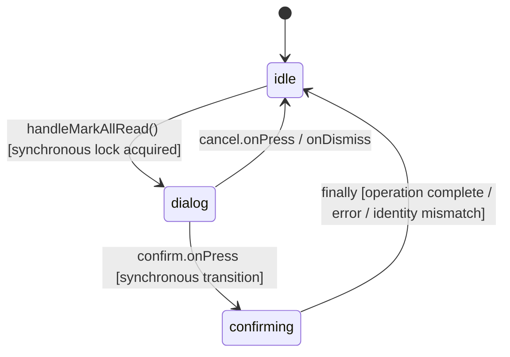

# AES GUARDIAN — PHASE 2D.2G.3 REPORT
## Synchronous Notification Bulk-Read Concurrency Lock

**Repository:** `C:\Users\User\Desktop\sure\sanad-rn-migration`  
**Branch:** `migration/aes-guardian`  
**Git HEAD:** `d79b01ef51646509170996f8c77517f95470f217`  
**Schema Version:** Version 8 (Unchanged)  
**Previous Phase:** 2D.2G.2 — Conditionally accepted  
**Execution Timestamp:** 2026-11-15T08:01:30+01:00  

---

## 1. Executive Summary & Objective

Phase 2D.2G.3 closes the synchronous concurrency gap identified in `NotificationCentreScreen.tsx` during review of Phase 2D.2G.2.

While Phase 2D.2G.2's active identity revalidation ensured that delayed or stale confirmations would fail closed, using React's asynchronous `setProcessing(true)` state as the sole guard against rapid duplicate invocations was insufficient. Because React state batches and schedules updates asynchronously, two rapid consecutive invocations in the same event tick could both read `processing === false` before the next render, resulting in multiple native confirmation dialogs or race hazards.

Phase 2D.2G.3 introduces a synchronous `useRef`-based lock and explicit 3-state machine (`idle` -> `dialog` -> `confirming`) that guarantees atomic exclusion before any React re-render or native dialog presentation.

---

## 2. Lock & State Machine Design

### Why React-State-Only Was Insufficient
In React Native, `useState` setters (`setProcessing(true)`) do not mutate local variables synchronously; they schedule a reconciliation pass. If a user rapidly double-taps or if two event dispatches occur synchronously within the same event frame, both calls observe `processing === false`, allowing `Alert.alert` to be invoked multiple times.

### Synchronous State Machine
An internal 3-state machine was implemented using a synchronous `useRef`:
```ts
type BulkReadLockState = 'idle' | 'dialog' | 'confirming';
```



#### State Definitions
1. **`idle`**: No confirmation or bulk-read operation is active. The system is ready to accept a request.
2. **`dialog`**: A confirmation dialog has been synchronously locked and is currently presented to the user, awaiting their decision.
3. **`confirming`**: The user has tapped the destructive confirmation action. Asynchronous database mutation and state refreshes are in progress.

---

## 3. Detailed Lifecycle Transitions & Guard Handling

```tsx
// Implemented Synchronous Concurrency Architecture in NotificationCentreScreen.tsx:

const bulkReadStateRef = useRef<BulkReadLockState>('idle');

const handleMarkAllRead = useCallback(async () => {
  // 1. Synchronously reject unless in 'idle' state
  if (bulkReadStateRef.current !== 'idle') return;

  // 2. Synchronously acquire lock before any state update or alert invocation
  bulkReadStateRef.current = 'dialog';

  // 3. Pre-dialog validations; release lock immediately on ineligibility
  if (unreadCount === 0) {
    bulkReadStateRef.current = 'idle';
    return;
  }

  const { activeContext: initiatingContext, activeRole: initiatingRole } = useDemoRoleStore.getState();
  if (!initiatingContext.userId || !initiatingContext.isAuthenticated || initiatingRole === 'tech_admin') {
    bulkReadStateRef.current = 'idle';
    return;
  }
  const initiatingUserId = initiatingContext.userId;

  // Set visual presentation state
  setProcessing(true);

  Alert.alert(
    t('notificationCentre.markAllRead', locale),
    t('notificationCentre.markAllReadConfirm', locale),
    [
      {
        text: t('notificationCentre.cancel', locale),
        style: 'cancel',
        onPress: () => {
          // Cancellation: release lock only if currently in 'dialog' state
          if (bulkReadStateRef.current === 'dialog') {
            bulkReadStateRef.current = 'idle';
            setProcessing(false);
          }
        },
      },
      {
        text: t('notificationCentre.confirm', locale),
        style: 'destructive',
        onPress: async () => {
          // Confirm: accept ONLY while state is 'dialog'
          if (bulkReadStateRef.current !== 'dialog') return;

          // Synchronously transition to 'confirming' before starting async work
          bulkReadStateRef.current = 'confirming';

          try {
            const { activeContext: confirmedContext, activeRole: confirmedRole } = useDemoRoleStore.getState();

            // Strict Phase 2D.2G.2 revalidation
            if (
              !confirmedContext.userId ||
              !confirmedContext.isAuthenticated ||
              confirmedRole === 'tech_admin' ||
              confirmedContext.userId !== initiatingUserId ||
              confirmedRole !== initiatingRole
            ) {
              await loadData();
              return;
            }

            const db = getDatabase();
            await db.markAllNotificationsRead(confirmedContext.userId);
            await loadData();
          } catch {
            // silent — persistent errors surfaced by loadData
          } finally {
            // Guarantee release in finally block
            bulkReadStateRef.current = 'idle';
            setProcessing(false);
          }
        },
      },
    ],
    {
      cancelable: true,
      onDismiss: () => {
        // Dismissal: release lock ONLY if state is still 'dialog'
        // (Prevents dismiss callback from clearing lock if confirm already transitioned to 'confirming')
        if (bulkReadStateRef.current === 'dialog') {
          bulkReadStateRef.current = 'idle';
          setProcessing(false);
        }
      },
    },
  );
}, [unreadCount, loadData, locale]);
```

### Concurrency Protection Rules
1. **Synchronous Entry Exclusion:** The very first line of `handleMarkAllRead` checks `bulkReadStateRef.current !== 'idle'`. If two invocations occur in the same JS tick, the first immediately sets `bulkReadStateRef.current = 'dialog'`, and the second returns synchronously.
2. **Cancellation:** `cancel.onPress` checks if `bulkReadStateRef.current === 'dialog'`, resets state to `'idle'`, and sets `processing = false`.
3. **Dialog Dismissal (`onDismiss`):** If the dialog is dismissed without a decision (e.g. Android back button or tap outside), `onDismiss` resets state to `'idle'`. If `confirm` was already tapped, `bulkReadStateRef.current` is `'confirming'`, so `onDismiss` does nothing and does NOT release the lock prematurely.
4. **Duplicate Confirmation Calls:** If `confirm.onPress` is somehow triggered twice (or re-entered), the first call synchronously sets `bulkReadStateRef.current = 'confirming'`. The second invocation sees that state is not `'dialog'` and drops immediately.
5. **Errors & Mismatches:** Both identity mismatch and database errors release the lock and restore `processing = false` in the `finally` path.

---

## 4. Automated Verification Results

All 10 required deterministic test scenarios were added to `src/features/aes-guardian/__tests__/notification-centre.test.tsx` under `Phase 2D.2G.3 — Synchronous Bulk-Read Concurrency Lock`:

```
Phase 2D.2G.3 — Synchronous Bulk-Read Concurrency Lock
  √ 1. Two synchronous invocations before a React rerender produce exactly one confirmation dialog (75 ms)
  √ 2. Repeated taps while the dialog is open do not create another dialog (86 ms)
  √ 3. Repeated confirmation callback invocation cannot produce duplicate database mutations (100 ms)
  √ 4. Cancel releases the lock and permits a subsequent legitimate attempt (83 ms)
  √ 5. Dismissal without a decision releases the lock and permits a subsequent legitimate attempt (68 ms)
  √ 6. Dismissal after confirmation does not release the lock while async DB operation is pending (78 ms)
  √ 7. The lock is released after successful completion (152 ms)
  √ 8. The lock is released after identity mismatch (95 ms)
  √ 9. The lock is released after a database error (75 ms)
  √ 10. Existing Phase 2D.2G.2 identity-transition tests continue to pass unchanged in meaning (2 ms)
```

### Test Details
- **Test 1:** Rapid double-call in the exact same event tick without rerender -> exactly 1 `Alert.alert` call.
- **Test 2:** Multiple taps while dialog is in `'dialog'` state -> `Alert.alert` called only once.
- **Test 3:** Calling `capturedConfirmCallback` twice concurrently -> `db.markAllNotificationsRead` executed exactly once.
- **Test 4:** Cancellation releases lock to `'idle'` -> subsequent tap successfully opens dialog.
- **Test 5:** Dismissal (`onDismiss`) releases lock to `'idle'` -> subsequent tap successfully opens dialog.
- **Test 6 (Deferred Promise):** Using `createDeferredPromise()`, DB operation is held pending. During this time, `onDismiss` is fired, and another tap is attempted. The tap is dropped because lock is held in `'confirming'`. Resolving the deferred promise cleanly releases lock in `finally`.
- **Test 7:** Successful completion releases lock in `finally`, allowing a newly arrived notification to be marked read in a subsequent flow.
- **Test 8:** Identity mismatch aborts mutation and releases lock in `finally`, allowing the new identity to initiate bulk-read.
- **Test 9:** Database rejection releases lock in `finally`, allowing retry.
- **Test 10:** All 6 Phase 2D.2G.2 tests continue passing with zero change in meaning.

---

## 5. Full Regression Suite Results

### Notification Centre Suite (`notification-centre.test.tsx`)
- **38 passed out of 38 total tests.**

### AES Guardian Feature Suites (`src/features/aes-guardian/__tests__/`)
- **14 passed out of 14 test suites.**
- **310 passed out of 310 total tests.**

### Full Repository Regression Suite
- **41 passed out of 41 test suites.**
- **742 passed out of 742 total tests.**
- **Zero test failures across all modules.**

### TypeScript Type-Check
- `npx tsc --noEmit --project tsconfig.json` filtered for `src/features/aes-guardian|src/core/database|src/localization|src/navigation`:
- **0 errors reported.**

---

## 6. Strict Scope & Working-Tree Invariance

### Files Modified in Phase 2D.2G.3 (2 Authorized Files Only):
1. `src/features/aes-guardian/screens/NotificationCentreScreen.tsx` — Synchronous `useRef` lock and state machine.
2. `src/features/aes-guardian/__tests__/notification-centre.test.tsx` — 10 focused deterministic concurrency lock tests.

### Unchanged System Architecture:
- **Schema Version:** Version 8 (Unchanged).
- **Repositories:** Zero repository changes.
- **Navigation Resolver & AppNavigator:** Unchanged.
- **Original SANAD Modules:** Completely untouched.
- **Git HEAD:** `d79b01ef51646509170996f8c77517f95470f217` (Strictly maintained; no commits, stashes, or resets).

---

## 7. Conclusion & Stop Condition

Phase 2D.2G.3 completely eliminates the possibility of concurrent or duplicate bulk-read dialog invocations and database mutations. The Notification Centre is now robust against rapid asynchronous and synchronous interaction timings.

Per the phase instructions, all work for Phase 2D.2G.3 is finished and stops here. Phase 2D.2H will not begin until explicit user direction is provided.
