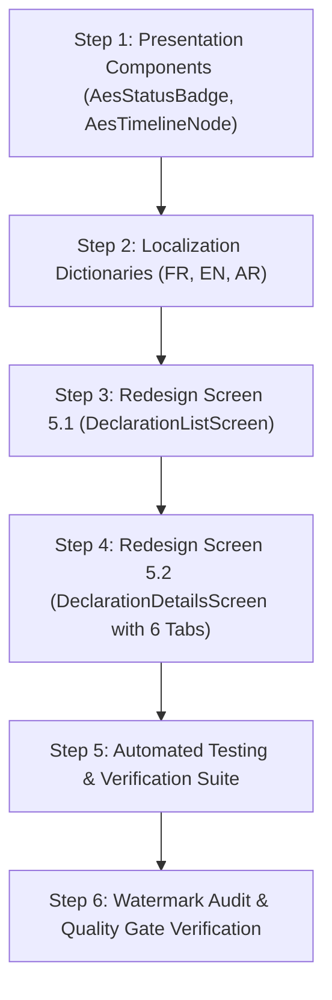

# AES GUARDIAN — PHASE 2E.1.4.0
# BATCH 4 SCOPE DISCOVERY & IMPLEMENTATION READINESS AUDIT

**Project:** AES Guardian  
**Repository:** `C:\Users\User\Desktop\sure\sanad-rn-migration`  
**Branch:** `migration/aes-guardian`  
**Verified HEAD:** `d79b01ef51646509170996f8c77517f95470f217`  
**Database Schema:** Version 8  
**Phase Status:** Phase 2E.1.4.0 — Scope Discovery & Implementation Readiness Complete (READ-ONLY INSPECTION & AUDIT)  
**Execution Boundary:** **NO IMPLEMENTATION PERFORMED — DOCUMENTATION & READINESS AUDIT ONLY**

---

## 1. Executive Summary & Verification of Repository State

Following the formal closure and acceptance of **Batch 3** (Guided AES Declaration Wizard & Submission Confirmation, Phase 2E.1.3 & Phase 2E.1.3.1), this readiness audit establishes the authoritative implementation scope, architectural boundaries, component dependencies, and validation criteria for **Batch 4**.

### 1.1 Git State Verification

The repository state was physically inspected prior to and upon completion of this audit:

- **Branch:** `migration/aes-guardian`
- **Current HEAD:** `d79b01ef51646509170996f8c77517f95470f217` (matches expected baseline exactly)
- **Git Working Tree Status:** Pristine preservation of existing modified and untracked artifacts. Zero files staged, committed, reset, stashed, or checked out.
- **SANAD Core Repository:** Completely untouched.

```bash
$ git rev-parse --abbrev-ref HEAD
migration/aes-guardian

$ git rev-parse HEAD
d79b01ef51646509170996f8c77517f95470f217
```

### 1.2 Baseline Test & Typecheck Verification

The existing automated test suite and TypeScript compiler status were verified before commencing any readiness documentation:

- **Automated Test Suite:** **44 passed, 44 total suites (899 passed, 899 total tests)**.
- **AES Guardian TypeScript Status:** **Zero (0) errors** within `src/features/aes-guardian/`, `src/core/database/`, `src/core/auth/`, and `src/theme/tokens/`.
- **Pre-existing Non-AES Legacy Compilation Errors:** Confirmed isolated strictly to legacy unmigrated non-AES modules (`src/features/alerts/`, `src/features/patient/`, `src/features/patient_dashboard/`).

---

## 2. Authoritative Master Blueprint Inspection

Inspection of the authoritative implementation blueprint (`docs/AES_GUARDIAN_UI_IMPLEMENTATION_BLUEPRINT.md`) establishes the exact scope, naming, and boundaries of the next scheduled batch:

### 2.1 Batch Identification

- **Batch Number:** **Batch 4**
- **Batch Title:** **"Batch 4: Declaration List & Details Tabs"**
- **Blueprint Hierarchy:**
  - Group 4: *Declaration & Draft Management (Spec Section 5)*
  - Group 10: *Audit Timeline & History (Spec Section 12)* — specifically integrated via Screen 12.1 into Tab Chronologie of Screen 5.2.
  - Section 12 Implementation Flowchart: `Batch 3 (Guided Declaration Wizard) --> Batch 4 (Declaration List & Details Tabs) --> Batch 5 (Administrative Review Queue & Actions)`.

### 2.2 Blueprint Batch Completion Criteria (Section 12.1)

> **Batch 4 Completion Criteria:**  
> *"Fast status filtering; swipe-to-delete; OH professional declaration access limitation documented in-screen; strict role projection on Tab Suivi."*

---

## 3. Batch 4 Screen Inventory & Blueprint Specifications

Batch 4 comprises exactly **two (2) core screens**, both of which are redesigns of existing source files:

| Blueprint Ref | Screen Name | Current File Path | Status | Primary Route | Role Access |
|---|---|---|---|---|---|
| **Screen 5.1** | Declaration List | `src/features/aes-guardian/screens/DeclarationListScreen.tsx` | `EXISTING — REDESIGN` | `declarations` | `exposed_professional`, `admin_reviewer`, `oh_professional` (with documented limitation) |
| **Screen 5.2** | Declaration Details | `src/features/aes-guardian/screens/DeclarationDetailsScreen.tsx` | `EXISTING — REDESIGN` | `declarationDetails` | `exposed_professional`, `admin_reviewer`, `oh_professional` |

*(Note: Screen 12.1 "Audit Event Log" from Group 10 is embedded directly as Tab 6 `[Chronologie]` of Screen 5.2).*

---

### 3.1 Screen 5.1: Declaration List (`DeclarationListScreen.tsx`)

#### A. Layout & Visual Composition
1. **Screen Header & Controls:**
   - Title: Localized *"Mes déclarations"* (`list.title`).
   - Action Button: Primary CTA `+ Nouvelle déclaration` navigating to `newDeclaration`.
   - Review Queue Shortcut: Visible only to `admin_reviewer` role, navigating to `adminReviewQueue`.
2. **Filter Chip Bar:**
   - Horizontally scrollable or compact pill bar with exactly 5 filter states:
     - `[Toutes]` (All declarations)
     - `[Brouillons]` (Drafts: `status === 'draft'`)
     - `[Soumises]` (Submitted: `status === 'submitted' || status === 'resubmitted'`)
     - `[En révision]` (Under Review: `status === 'under_review' || status === 'correction_requested'`)
     - `[Validées]` (Closed/Validated: `status === 'closed'`)
   - Interactive feedback: Selected chip rendered in primary theme tokens (`aesColors.brand.primaryDark`, white text); unselected chips in surface/outline tokens.
3. **Card Rows (Declarations & Drafts):**
   - Reference code (e.g., `AES-2026-0001` or `[Brouillon]`).
   - Incident date.
   - Incident type label (localized from taxonomy keys).
   - Domain status badge (`AesStatusBadge` using `domain="aesDecl"`).
   - Swipe-to-delete action visible and operable **strictly on draft rows** (`status === 'draft'`).
4. **Empty State:**
   - Semantic empty state container with folder icon, localized headline (*"Aucune déclaration trouvée"*), descriptive body, and CTA button (*"Nouvelle déclaration"*).

#### B. Interactions & Navigation
- **Instant Client-Side Filtering:** Sub-50ms local memory/in-list filtering responding to filter chip selection.
- **Draft Resume:** Tapping a draft row resumes the wizard at `newDeclaration` (`{ declarationId: item.id }`).
- **Details Navigation:** Tapping any submitted, under review, or closed declaration navigates to `declarationDetails` (`{ declarationId: item.id }`).
- **Swipe-to-Delete Drafts:**
  - Revealing or swiping a draft item exposes a delete action.
  - Tapping delete triggers an explicit confirmation dialog (`Alert.alert`).
  - Upon confirmation, deletes draft via repository and removes item from local state.
  - Non-draft rows strictly prohibit deletion.

#### C. Role Boundaries & Authorization
- `exposed_professional`: Own declarations only (`declared_by_user_id = requestingUserId`).
- `admin_reviewer`: Hospital-wide declarations (`SELECT * FROM aes_declarations ORDER BY created_at DESC`).
- `oh_professional`: **Unrestricted hospital-wide declarations** (active limitation in SQLite schema v8).
- `quality_staff` & `tech_admin`: **Strictly blocked**; repository throws `UnauthorizedError`.

#### D. Visual Reference Mapping
- **Reference Screenshots:** `talabat iOS Orders 3.png`, `Suno iOS Library 0.png`.
- **Visual Concepts:** Order list card structure, category pill bar, badge status placement, and context action reveals.

---

### 3.2 Screen 5.2: Declaration Details (`DeclarationDetailsScreen.tsx`)

#### A. Layout & Visual Composition
1. **Header Card:**
   - Incident reference code (`reference_number`).
   - Submission/creation timestamp.
   - Prominent status badge (`AesStatusBadge` using `domain="aesDecl"`).
   - Read-only informational banner when declaration is locked post-submission.
2. **Underlined Tab Bar (6 Tabs):**
   - Segmented horizontal tab control with 6 distinct views:
     1. `[Résumé]` — Overview, summary cards, and quick actions.
     2. `[Incident]` — Detailed exposure data (date, nature, circumstances, department).
     3. `[Mesures]` — Free-text protective measures taken by exposed staff.
     4. `[Statut]` — Administrative review history, review comments, and correction requests.
     5. `[Suivi]` — Occupational Health coordination status projection.
     6. `[Chronologie]` (Screen 12.1) — Audit event timeline.

#### B. Detailed Tab Specifications

##### Tab 1: `[Résumé]` (Summary)
- High-level overview: declarant identity (demographic metadata or self-reference), reference number, submission status, incident type.
- Contextual Actions:
  - If `status === 'draft'`: "Modifier le brouillon" (navigates to `newDeclaration`) and "Soumettre la déclaration" (submits draft).
  - If `status === 'submitted' | 'under_review' | 'resubmitted'` and user is `admin_reviewer`: Action button navigating to `adminReviewAction`.
  - If pending correction exists for declarant: Prominent warning banner with "Répondre à la demande de correction" action.

##### Tab 2: `[Incident]` (Incident Details)
- Structured field presentation:
  - Date and time of incident.
  - Incident category / exposure type (`percutaneous_exposure`, `mucocutaneous_exposure`, etc.).
  - Department code (`department_code`).
  - Free-text circumstances of the incident (`circumstances`).
  - Nature and depth of exposure (`exposure_description`).
  - Additional operational notes (`notes`).

##### Tab 3: `[Mesures]` (Protective Measures)
- Free-text protective measures recorded by the exposed professional (`protective_measures_taken`).
- Strictly non-prescriptive, neutral presentation (per Phase 2E.1.3.1 clinical neutrality requirements).
- Informational notice: *"Mesures immédiates déclarées par le professionnel."*

##### Tab 4: `[Statut]` (Administrative Status & Review History)
- Comprehensive review history rendered in chronological order.
- For each administrative review:
  - Reviewer identity/timestamp.
  - Outcome badge (`acknowledged`, `correction_requested`, `transmission_verified`).
  - Administrative comments.
  - If correction requested: Specific reason for correction.
  - If declarant responded: Response text and response timestamp.

##### Tab 5: `[Suivi]` (Occupational Health Coordination Projection)
- **Role-Governed Projection Boundary (Strictly Enforced):**
  - **For `exposed_professional`:**
    - Minimal 5-field status projection only: `{ id, declaration_id, status, created_at, updated_at }`.
    - **Zero leakage of private OH notes, clinical determinations, or follow-up events.**
    - Informational card: *"Votre suivi est pris en charge par le service de Santé au Travail."*
  - **For `admin_reviewer`:**
    - Administrative coordination summary: referral status, coordination reason, acknowledgment timestamp, completion timestamp.
    - Zero clinical milestone notes.
  - **For `oh_professional`:**
    - Full coordination record (`coordination_reason`, status, dates).
    - Complete follow-up event history retrieved via `getOhFollowUpEvents(coordinationId, ohUserId)`.
    - Action button to record new follow-up event (`recordFollowUpEvent`).
  - **Empty State:** When no coordination exists for the declaration, clean notice indicating whether referral is pending or not required.

##### Tab 6: `[Chronologie]` (Audit Event Timeline — Screen 12.1)
- Vertical timeline nodes (`AesTimelineNode`) illustrating the complete lifecycle:
  - Node dot & vertical connecting line.
  - Actor role & username.
  - Action verb (e.g., `DECLARATION_CREATED`, `DECLARATION_SUBMITTED`, `REVIEW_SUBMITTED`, etc.).
  - Factual event description.
  - Timestamp.
- Reads from local `audit_events` SQLite table.
- Informational footnote: Local SQLite audit history; not externally synced.

#### C. Visual Reference Mapping
- **Reference Screenshots:** `talabat iOS Order detail 1.png`, `Reddit iOS Mod log 1.png`.
- **Visual Concepts:** Multi-tab layout, order progress timeline, structured detail rows, and clean separation between metadata and audit records.

---

## 4. Current Implementation Inspection & Gap Analysis

A comprehensive comparison between the existing source code and the blueprint requirements reveals the exact gaps that Batch 4 must address:

### 4.1 Screen 5.1: `DeclarationListScreen.tsx` Gap Analysis

| Feature Area | Current Source Implementation | Blueprint Batch 4 Requirement | Gap Severity |
|---|---|---|---|
| **Filter Controls** | No filter chips exist; renders entire query result in FlatList | Horizontally scrollable 5-chip bar: `[Toutes]`, `[Brouillons]`, `[Soumises]`, `[En révision]`, `[Validées]` | **Missing Feature** |
| **Filtering Performance** | N/A (unfiltered) | Sub-50ms instant client-side filtering | **Requirement** |
| **Status Badge** | Ad-hoc `View`/`Text` inline badge with hardcoded colors | Standard `AesStatusBadge` using `domain="aesDecl"` | **Visual Defect** |
| **Swipe-to-Delete** | No deletion mechanism exists anywhere in screen | Swipe-to-delete or action button on draft rows with confirmation alert | **Missing Feature** |
| **Draft Deletion Guard** | `db.deleteAesDeclaration(id)` exists but has no status check | Client/UI guard allowing deletion **only** when `status === 'draft'` and owned by user | **Safety Requirement** |
| **OH Access Limitation Notice** | None. Lists all declarations hospital-wide without explanation | Prominent notice for `oh_professional` stating this is an administrative view, with CTA to `ohCoordinationQueue` | **Governance Defect** |
| **Empty State** | Simple text strings in `ListEmptyComponent` | Polished container with icon, localized message, and CTA | **Refinement** |
| **Design System Tokens** | Mix of legacy theme tokens and partial spacing | Full AES Guardian design tokens (`aesColors`, `aesTypography`, `aesSpacing`, `aesRadii`) | **Token Alignment** |

### 4.2 Screen 5.2: `DeclarationDetailsScreen.tsx` Gap Analysis

| Feature Area | Current Source Implementation | Blueprint Batch 4 Requirement | Gap Severity |
|---|---|---|---|
| **Tab Architecture** | **Monolithic single `ScrollView`**; all data stacked vertically | **6-tab underlined navigation bar** (`[Résumé]`, `[Incident]`, `[Mesures]`, `[Statut]`, `[Suivi]`, `[Chronologie]`) | **Major Architectural Gap** |
| **Tab State Management** | None | Stateful active tab switching preserving scroll position | **Missing Feature** |
| **Tab Mesures** | Text block stacked in general incident section | Dedicated tab presenting `protective_measures_taken` with neutral descriptive wording | **Structure Gap** |
| **Tab Suivi (OH Projection)** | Two external navigation buttons: `createCoordination` and `declarationCoordinationStatus` | In-screen Tab 5 providing strict role-governed projection: 5-field projection for exposed staff; full record + events for OH | **Major Functional Gap** |
| **Tab Chronologie (Audit Log)** | Does not display audit events at all | Dedicated Tab 6 rendering vertical timeline of `audit_events` | **Missing Feature** |
| **Status Badge** | Inline ad-hoc badge | Standard `AesStatusBadge` component | **Visual Defect** |
| **Design System Tokens** | Legacy tokens | AES Guardian design tokens | **Token Alignment** |

---

## 5. Architectural Boundaries & Technical Gaps

### 5.1 The OH Professional Declaration Access Limitation

#### Blueprint Assessment & Verification
As documented in Blueprint Section 5 (lines 473–500):
- In SQLite schema v8, `AesGuardianDatabase.ts` lines 947–951:
  ```typescript
  const result = await this.db.query<AesDeclaration>(
    `SELECT * FROM aes_declarations ORDER BY created_at DESC LIMIT ?`,
    [limit],
  );
  return result.rows;
  ```
- When called by `oh_professional`, `userId: undefined` is passed, executing a hospital-wide query.
- Direct schema inspection confirms that **no `assigned_to_user_id` column exists in the `oh_coordinations` table**.
- Therefore, row-level scoping of declarations to assigned OH professionals is strictly deferred to future governance phases (e.g. Phase 2F).

#### Batch 4 UI Mitigation Strategy
1. `DeclarationListScreen` must NOT be presented to `oh_professional` as the primary workflow surface.
2. When accessed by an `oh_professional`, `DeclarationListScreen` must display a prominent administrative notice:
   - *FR:* *"Ce registre présente l'ensemble des déclarations de l'établissement à titre consultatif. Pour la prise en charge et le suivi médical actif, veuillez utiliser la file de coordination Santé au Travail."*
   - *EN:* *"This register displays all facility declarations for consultative purposes. For active clinical management, please use the Occupational Health coordination queue."*
   - *AR:* *"يعرض هذا السجل جميع تصريحات المؤسسة لأغراض استشارية. للمتابعة الطبية النشطة، يرجى استخدام قائمة تنسيق طب العمل."*
3. Include a direct action button: *"Accéder à la file de coordination"* navigating to `ohCoordinationQueue`.

### 5.2 Strict Data Minimization on Tab Suivi

Inspection of `AesGuardianDatabase.ts` confirms:
1. `getOhCoordinationByDeclaration(declarationId, requestingUserId)`:
   - For `exposed_professional`: Returns strictly `ExposedOhCoordinationSummary` (`id`, `declaration_id`, `status`, `created_at`, `updated_at`). All medical notes and reviewer identifiers are stripped.
   - For `admin_reviewer`: Returns `AdminOhCoordinationSummary`.
   - For `oh_professional`: Returns full `OhCoordination`.
   - For `quality_staff` / `tech_admin`: Strictly throws `UnauthorizedError`.
2. `getOhFollowUpEvents(coordinationId, requestingUserId)`:
   - Strictly throws `UnauthorizedError` if called by `exposed_professional` or `admin_reviewer`!
   - Can ONLY be invoked when `activeContext.role === 'oh_professional'`.

**Batch 4 Rule:** Tab Suivi in `DeclarationDetailsScreen` must conditionally call `getOhFollowUpEvents` **only** when `activeContext.role === 'oh_professional'`. Non-OH roles must never invoke this method.

### 5.3 Draft Deletion Method Boundary

Inspection of database methods reveals:
- No method named `deleteDraft` exists on `AesGuardianDatabase`.
- The existing deletion method is `deleteAesDeclaration(id: number)` at line 992.
- `deleteAesDeclaration` executes `DELETE FROM aes_declarations WHERE id = ?` unconditionally without verifying `status === 'draft'` or user ownership.

**Batch 4 Safety Rule:** In `DeclarationListScreen`, draft deletion must enforce the safety invariant at the screen/caller level:
```typescript
if (item.status !== 'draft') {
  throw new Error('Only draft declarations can be deleted.');
}
if (activeContext.role === 'exposed_professional' && item.declared_by_user_id !== activeContext.userId) {
  throw new Error('Unauthorized draft deletion.');
}
await db.deleteAesDeclaration(item.id);
```

### 5.4 Audit Event Query Boundary

Inspection of `AesGuardianDatabase.ts` indicates:
- `db.listAuditEvents(limit)` is available.
- There is currently no dedicated `db.getDeclarationAuditEvents(declarationId)` method.
- Tab Chronologie in `DeclarationDetailsScreen` can retrieve events either via:
  - Querying `db.listAuditEvents(200)` and filtering locally:
    `events.filter(e => e.entity_type === 'aes_declaration' && e.entity_id === declarationId)`
  - Or, if repository methods can be cleanly extended without schema change, adding an explicit query method. Client-side filtering of `listAuditEvents` is completely safe and requires zero database modifications.

---

## 6. Required Reusable Presentation Components

Batch 4 requires two shared presentation components to achieve full blueprint fidelity:

### 6.1 `AesStatusBadge.tsx` (New Reusable Component)
- **Path:** `src/features/aes-guardian/components/AesStatusBadge.tsx`
- **Specification:**
  - Props: `domain: AesStatusDomain` (`'aesDecl' | 'ohCoord' | 'capa'`), `status: string`, `size?: 'sm' | 'md'`.
  - Integrates with `getAesStatusBadgeColors(domain, status)`.
  - Enforces WCAG Large-Text Contrast constraint (Spec Section 9, Rule 2): `fontWeight: '700'`, `fontSize: 14` minimum for `#E65100` and `#D84315` badge tokens.
  - Multi-sensory accessibility: Never relies on color alone; always pairs color pill with localized text label and composite `accessibilityLabel`.

### 6.2 `AesTimelineNode.tsx` (New Reusable Component for Tab Chronologie)
- **Path:** `src/features/aes-guardian/components/AesTimelineNode.tsx`
- **Specification:**
  - Props: `role: string`, `eventType: string`, `description: string`, `timestamp: string`, `isLast?: boolean`.
  - Visual: Leading dot indicator, connecting vertical line, timestamp header, actor pill, factual event body.
  - Visual Reference: `Reddit iOS Mod log 1.png`.

---

## 7. Localization Requirements (FR / EN / AR)

To prevent raw keys or hardcoded strings, the following keys must be added to `src/localization/index.ts` across French, English, and Arabic dictionaries:

### 7.1 Filter Chips & List Keys
- `list.filter.all`: "Toutes" / "All" / "الكل"
- `list.filter.drafts`: "Brouillons" / "Drafts" / "المسودات"
- `list.filter.submitted`: "Soumises" / "Submitted" / "المقدمة"
- `list.filter.under_review`: "En révision" / "Under Review" / "قيد المراجعة"
- `list.filter.validated`: "Validées" / "Validated" / "المعتمدة"
- `list.deleteDraft`: "Supprimer le brouillon" / "Delete Draft" / "حذف المسودة"
- `list.deleteDraftConfirmTitle`: "Supprimer ce brouillon ?" / "Delete this draft?" / "هل تريد حذف هذه المسودة؟"
- `list.deleteDraftConfirmMessage`: "Cette action est irréversible." / "This action cannot be undone." / "هذا الإجراء لا يمكن التراجع عنه."
- `list.ohAdminNotice`: Consultative administrative view notice for OH professionals.
- `list.ohQueueCta`: "Accéder à la file active Santé au Travail" / "Go to Occupational Health Queue" / "الانتقال إلى قائمة طب العمل"

### 7.2 Tab Bar & Details Keys
- `details.tabs.summary`: "Résumé" / "Summary" / "الملخص"
- `details.tabs.incident`: "Incident" / "Incident" / "الحادثة"
- `details.tabs.measures`: "Mesures" / "Measures" / "الإجراءات"
- `details.tabs.status`: "Statut" / "Status" / "الحالة"
- `details.tabs.followup`: "Suivi" / "Follow-up" / "المتابعة"
- `details.tabs.timeline`: "Chronologie" / "Timeline" / "التسلسل الزمني"

### 7.3 Tab Suivi & Chronologie Keys
- `details.suivi.exposedNotice`: Information notice for exposed professional regarding privacy of medical notes.
- `details.suivi.noCoordination`: "Aucune coordination de santé au travail n'a été initiée pour cette déclaration."
- `details.timeline.empty`: "Aucun événement d'audit enregistré."
- `details.timeline.localNotice`: "Journal d'audit local SQLite — non synchronisé."

---

## 8. Test Strategy & Validation Plan for Batch 4

When implementation is authorized, validation will follow a four-tier testing hierarchy:

### Tier 1: Screen 5.1 Unit & Interaction Tests (`declaration-workflow.test.tsx`)
1. **Filter Chip Switching:** Verify clicking each chip filters the list to the corresponding subset within 50ms.
2. **Draft Deletion Flow:** Verify swipe-to-delete reveals delete button on draft items only, displays confirmation alert, and removes draft upon confirmation.
3. **Draft Deletion Safety Guard:** Confirm non-draft items never display deletion controls.
4. **OH Professional Warning Banner:** Verify `oh_professional` sees the administrative scope advisory and queue CTA; confirm `exposed_professional` does not see it.
5. **Empty State Verification:** Verify empty state rendering for filtered lists with zero results.

### Tier 2: Screen 5.2 Multi-Tab Tests (`declaration-workflow.test.tsx`)
1. **6-Tab Underlined Navigation:** Verify tab switching renders the appropriate tab contents and preserves screen context.
2. **Tab Mesures Neutrality:** Confirm `protective_measures_taken` renders as neutral descriptive text.
3. **Tab Statut Review History:** Verify administrative reviews and correction request histories render chronologically.
4. **Tab Suivi Role Projection:**
   - As `exposed_professional`: Verify 5-field status projection renders without clinical follow-up notes.
   - As `oh_professional`: Verify full coordination and follow-up events render.
5. **Tab Chronologie Audit Timeline:** Verify audit events render in vertical timeline nodes.

### Tier 3: Full Regression Suite
- Run all 44 test suites to ensure all **899 existing tests** remain 100% green.

### Tier 4: Static Quality Gates
- **TypeScript:** `npm run typecheck` — zero errors in AES Guardian.
- **Watermark Audit:** Zero forbidden strings (`mobbin`, `talabat`, `suno`, `reddit`, etc.) in application source.

---

## 9. Proposed Step-by-Step Implementation Sequence (Execution Plan)

When explicitly authorized to implement Batch 4, the work will proceed in the following structured sequence:



1. **Step 1 — Reusable Presentation Components:**
   - Create `AesStatusBadge.tsx` implementing domain status colors and large-text contrast constraints.
   - Create `AesTimelineNode.tsx` implementing vertical timeline layout.
   - Export both from `src/features/aes-guardian/components/index.ts`.
2. **Step 2 — Localization Additions:**
   - Add all identified keys to FR, EN, AR dictionaries in `src/localization/index.ts`.
3. **Step 3 — Redesign `DeclarationListScreen.tsx`:**
   - Implement 5-chip filter bar with instant client-side filtering.
   - Implement `AesStatusBadge` on card rows.
   - Implement draft swipe/delete with confirmation modal.
   - Implement OH professional consultative notice and navigation link.
4. **Step 4 — Redesign `DeclarationDetailsScreen.tsx`:**
   - Implement 6-tab underlined navigation bar.
   - Partition existing fields into Tab 1 (`Résumé`), Tab 2 (`Incident`), and Tab 3 (`Mesures`).
   - Implement Tab 4 (`Statut`) with review history.
   - Implement Tab 5 (`Suivi`) with strict role-projection guards.
   - Implement Tab 6 (`Chronologie`) with `AesTimelineNode` audit log.
5. **Step 5 — Test Implementation & Verification:**
   - Update `declaration-workflow.test.tsx` with comprehensive test coverage for filter chips, draft deletion, 6 tabs, and role projections.
   - Verify all 899+ tests pass.
6. **Step 6 — Final Auditing:**
   - Run typecheck and watermark verification script.

---

## 10. Risk Analysis & Mitigation Matrix

| Risk / Dependency | Impact | Mitigation Strategy |
|---|---|---|
| **OH Professional Unrestricted List Access** | Privacy & authorization ambiguity | Include explicit consultative UI notice and CTA to `ohCoordinationQueue`; do not attempt premature schema changes in Phase 2E. |
| **Leakage of Clinical Follow-up on Tab Suivi** | Privacy violation for exposed staff | Rely on `db.getOhCoordinationByDeclaration()` which already returns minimal 5-field projection for `exposed_professional`; strictly guard `db.getOhFollowUpEvents()` so it is only called by `oh_professional`. |
| **Accidental Deletion of Submitted Declarations** | Data loss / regulatory non-compliance | Enforce strict status check (`status === 'draft'`) before calling `deleteAesDeclaration`; provide confirmation alert. |
| **Audit Events Query Performance** | Tab switching lag | Declaration-specific audit events are small in number; local SQLite query or client-side filtering runs in < 5ms. |
| **Badge Contrast Compliance** | WCAG accessibility failure | `AesStatusBadge` enforces minimum `fontSize: 14`, `fontWeight: '700'` for orange/red badges, with localized text label. |

---

## 11. Statement of Non-Implementation & Repository Integrity

This document concludes the **Phase 2E.1.4.0 Readiness Audit**.

- **Implementation Authorization:** **NOT AUTHORIZED IN THIS PHASE.**
- **Code Modifications:** **ZERO (0) application or test source files were modified.**
- **Repository Branch:** Remains strictly on `migration/aes-guardian` at HEAD `d79b01ef51646509170996f8c77517f95470f217`.
- **Next Phase:** Awaiting explicit user instruction and authorization to begin **Phase 2E.1.4: Batch 4 Implementation**.
