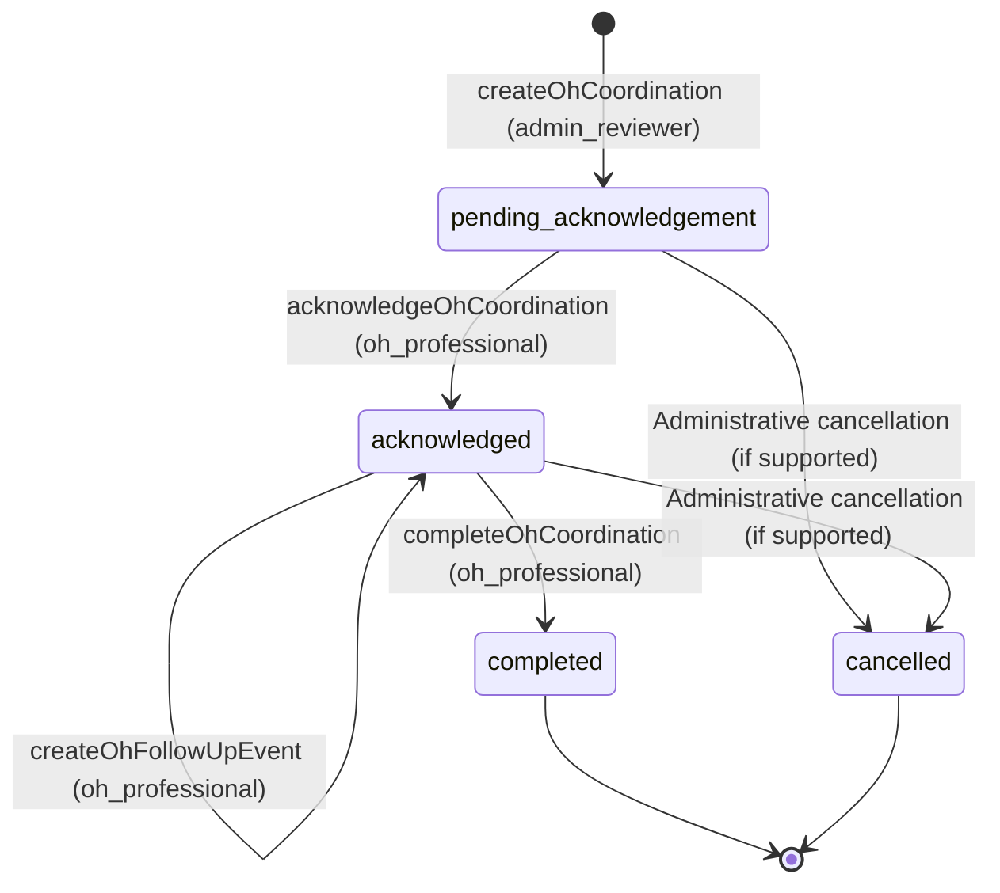

# AES GUARDIAN — PHASE 2E.1.6.0
## Batch 6 Scope Discovery & Readiness Audit Report

**Project:** AES Guardian  
**Repository:** `C:\Users\User\Desktop\sure\sanad-rn-migration`  
**Branch:** `migration/aes-guardian`  
**Expected HEAD:** `d79b01ef51646509170996f8c77517f95470f217`  
**Database Schema:** Version 8  
**Phase Type:** READ-ONLY SCOPE DISCOVERY & IMPLEMENTATION READINESS AUDIT  
**Date:** 2026-11-15  

---

## 1. Preflight Verification

- **Branch:** `migration/aes-guardian` `[VERIFIED IN SOURCE]`
- **HEAD Commit:** `d79b01ef51646509170996f8c77517f95470f217` `[VERIFIED IN SOURCE]`
- **Schema Version:** 8 (`CURRENT_SCHEMA_VERSION = 8` in `src/core/database/AesGuardianDatabase.ts`) `[VERIFIED IN SOURCE]`
- **Working Tree Integrity:** All 47 pre-existing modified and untracked files are preserved intact. `[VERIFIED IN SOURCE]`
- **Repository Safety:** Zero modifications to original SANAD codebase; zero commits, pushes, stashes, resets, cleans, rebases, or branch switches performed.

---

## 2. Verified Screen and Route Inventory

Verification against `src/navigation/routes.ts` and `src/navigation/AppNavigator.tsx`:

| Screen File | Route Name | Route Parameter Schema | Authorized Primary Role | Secondary Projections Supported |
| :--- | :--- | :--- | :--- | :--- |
| `src/features/aes-guardian/screens/OhCoordinationQueueScreen.tsx` | `ohCoordinationQueue` | `undefined` | `oh_professional` | None (exclusive inbox) |
| `src/features/aes-guardian/screens/OhCoordinationDetailScreen.tsx` | `ohCoordinationDetail` | `{ coordinationId: number }` | `oh_professional` | `admin_reviewer` (read-only admin summary), `exposed_professional` (5-field status only) |
| `src/features/aes-guardian/screens/CreateCoordinationScreen.tsx` | `createCoordination` | `{ declarationId: number }` | `admin_reviewer` | None (creation action only) |
| `src/features/aes-guardian/screens/OhFollowUpEventScreen.tsx` | `recordFollowUpEvent` | `{ coordinationId: number }` | `oh_professional` | None (event entry only) |

*(Note: In `src/navigation/routes.ts` line 33 and `AppNavigator.tsx` line 322, the route for `OhFollowUpEventScreen` is explicitly named `recordFollowUpEvent` with parameter `{ coordinationId: number }`, not `ohFollowUpEvent`).* `[VERIFIED IN SOURCE]`

---

## 3. Screen-by-Screen Current Implementation Findings

### 3.1 `OhCoordinationQueueScreen.tsx`
- **Current State:** Functional prototype from Phase 2C.4 using legacy styles and ThemeContext. `[VERIFIED IN SOURCE]`
- **Role Guard:** `canFollowUp(authContext)` enforced from `useDemoRoleStore()`. Fails closed if unauthorized. `[VERIFIED IN SOURCE]`
- **Repository Method Called:** `db.listOhCoordinationsQueue(authContext.userId)`. `[VERIFIED IN SOURCE]`
- **Data Retrieved & Rendered:** `declaration_reference`, `status`, `coordination_reason`, `creator_name`. `[VERIFIED IN SOURCE]`
- **Privacy & Safety:** Strictly queries coordinations in `'pending_acknowledgement'` or `'acknowledged'` status. Does not retrieve or render hospital-wide declarations, employee IDs, overdue badges, or clinical data. `[VERIFIED IN SOURCE]`
- **Design System Gap:**
  - Uses legacy `spacing, typography, shapes` instead of AES tokens.
  - Custom inline status badge (`#fff` on variable background) instead of `AesStatusBadge domain="ohCoordination"`.
  - Lacks segmented status filtering tabs (`[En attente de prise en charge]`, `[Suivi en cours]`, `[Suivi terminé]`) defined in master blueprint Section 7.1.
  - Action button touch target is < 48dp (`paddingVertical: spacing.xs`).
- **Classification:** **READY WITH CONDITIONS**

### 3.2 `OhCoordinationDetailScreen.tsx`
- **Current State:** Functional prototype from Phase 2C.4 supporting role-differentiated views. `[VERIFIED IN SOURCE]`
- **Role Guard:** Multi-role gate allowing `oh_professional` (full read/write), `admin_reviewer` (read-only admin summary), and `exposed_professional` (read-only status). `quality_staff` and `tech_admin` fail closed. `[VERIFIED IN SOURCE]`
- **Repository Methods Called:**
  - `db.getOhCoordinationById(coordinationId, authContext.userId)`
  - `db.getOhFollowUpEvents(coordinationId, authContext.userId)` (invoked only if `isOhProfessional`)
  - `db.acknowledgeOhCoordination(coordinationId, authContext.userId)`
  - `db.completeOhCoordination(coordinationId, authContext.userId)`
- **Data Retrieved & Rendered:**
  - `exposed_professional`: only `status`, `declaration_reference`.
  - `admin_reviewer`: `declaration_reference`, `status`, `coordination_reason`.
  - `oh_professional`: `declaration_reference`, `status`, `coordination_reason`, `creator_name`, `acknowledger_name`, `completer_name`, and full follow-up event history.
- **Privacy & Safety Observation:**
  - Fallback display string in lines 219 and 225 renders `User #${coordination.acknowledged_by_user_id}` and `User #${coordination.completed_by_user_id}` if display names are missing. This leaks internal database primary keys. Must be sanitized to neutral text or omitted. `[DOCUMENTED DESIGN DECISION]`
- **Design System Gap:**
  - Uses legacy `ScrollView`, `View`, `Text`, `TouchableOpacity` rather than `AesScreenContainer`, `AesScreenHeader`, `AesCard`, `AesButton`.
  - Custom status badge rather than `AesStatusBadge domain="ohCoordination"`.
- **Classification:** **READY WITH CONDITIONS**

### 3.3 `CreateCoordinationScreen.tsx`
- **Current State:** Functional administrative referral creation form from Phase 2C.4. `[VERIFIED IN SOURCE]`
- **Role Guard:** `canCoordinate(authContext)` strictly enforced for `admin_reviewer`. Other roles fail closed. `[VERIFIED IN SOURCE]`
- **Repository Method Called:** `db.createOhCoordination({ declaration_id, created_by_user_id, coordination_reason })`. `[VERIFIED IN SOURCE]`
- **Duplicate Prevention:** Repository enforces uniqueness; throws `'active coordination already exists for declaration ...'`. Handled in UI with friendly alert `t('oh.error.alreadyActive')`. `[VERIFIED IN SOURCE & TEST]`
- **Data Rendered:** `OH_COORDINATION_REASONS` taxonomy (4 categories), prototype disclaimer, clinical safety note, submit button with confirmation alert. `[VERIFIED IN SOURCE]`
- **Design System Gap:**
  - Uses legacy components and styles. Requires `AesScreenContainer`, `AesScreenHeader`, `AesCard`, `AesButton`.
- **Classification:** **READY WITH CONDITIONS**

### 3.4 `OhFollowUpEventScreen.tsx`
- **Current State:** Functional follow-up milestone recording form from Phase 2C.4. `[VERIFIED IN SOURCE]`
- **Role Guard:** `canFollowUp(authContext)` strictly enforced for `oh_professional`. Other roles fail closed. `[VERIFIED IN SOURCE]`
- **Repository Method Called:** `db.createOhFollowUpEvent({ coordination_id, event_category, event_date, recorded_by_user_id, administrative_note })`. `[VERIFIED IN SOURCE]`
- **Data Rendered:** `OH_FOLLOW_UP_EVENT_CATEGORIES` taxonomy (6 categories), ISO event date input, administrative note text area with 300 character limit, submit button. `[VERIFIED IN SOURCE]`
- **Safety Safeguards:** Strictly labels notes as non-clinical administrative notes (`t('oh.disclaimer.clinical')`). Does not allow lab results, medication names, or diagnoses. `[VERIFIED IN SOURCE]`
- **Design System Gap:**
  - Uses legacy components and styles. Requires `AesScreenContainer`, `AesScreenHeader`, `AesCard`, `AesButton`.
- **Classification:** **READY WITH CONDITIONS**

---

## 4. Repository Authorization & Projection Matrix

The following table documents the exact repository enforcement in `src/core/database/AesGuardianDatabase.ts`:

| Repository Method | `exposed_professional` | `admin_reviewer` | `oh_professional` | `quality_staff` | `tech_admin` |
| :--- | :---: | :---: | :---: | :---: | :---: |
| `listOhCoordinationsQueue` | Denied (Error) | Denied (Error) | **Authorized (Queue)** | Denied (Error) | Denied (Error) |
| `listOhCoordinationsForAdmin` | Denied (Error) | **Authorized (Own Created)** | Denied (Error) | Denied (Error) | Denied (Error) |
| `getOhCoordinationById` | **Authorized (5 fields: own only)** | **Authorized (Admin Summary)** | **Authorized (Full Record)** | Denied (Error) | Denied (Error) |
| `createOhCoordination` | Denied (Error) | **Authorized (Initiate)** | Denied (Error) | Denied (Error) | Denied (Error) |
| `acknowledgeOhCoordination`| Denied (Error) | Denied (Error) | **Authorized (Acknowledge)** | Denied (Error) | Denied (Error) |
| `completeOhCoordination` | Denied (Error) | Denied (Error) | **Authorized (Complete)** | Denied (Error) | Denied (Error) |
| `getOhFollowUpEvents` | Denied (Error) | Denied (Error) | **Authorized (View Events)** | Denied (Error) | Denied (Error) |
| `createOhFollowUpEvent` | Denied (Error) | Denied (Error) | **Authorized (Log Event)** | Denied (Error) | Denied (Error) |
| `getDeclarationForCoordinationInternal` | Denied (Error) | Denied (Error) | **Authorized (Scoped to Coord)** | Denied (Error) | Denied (Error) |

`[VERIFIED IN SOURCE: AesGuardianDatabase.ts lines 1484-2172]`  
`[VERIFIED BY TEST: oh-coordination-workflow.test.ts (53 tests passed)]`

---

## 5. OH Coordination Workflow & State-Transition Map

### State-Machine Invariants `[VERIFIED IN SOURCE & TEST]`
1. **Creation:** Initial status is always `pending_acknowledgement`. Created by `admin_reviewer`. Only 1 active coordination allowed per declaration.
2. **Acknowledgement:** Can only transition from `pending_acknowledgement` to `acknowledged`. Performed exclusively by `oh_professional`.
3. **Follow-Up Events:** Can **only** be recorded when coordination status is `acknowledged`. Cannot record events on `pending_acknowledgement`, `completed`, or `cancelled`.
4. **Completion:** Can only transition from `acknowledged` to `completed`. Performed exclusively by `oh_professional`. Irreversible action.

---

## 6. Clinical and Institutional Scope Safeguards

The Batch 6 implementation must adhere to strict clinical safety boundaries:

- **NO Serology Protocols:** No hardcoded schedules for T0 (baseline), M3 (3 months), or M6 (6 months) serologies. `[CRITICAL SAFEGUARD]`
- **NO PEP Recommendations:** No advice or decision trees regarding Post-Exposure Prophylaxis (PEP / Trithérapie).
- **NO Medication Instructions:** Zero pharmaceutical names, dosages, or prescription handling.
- **NO Risk Scoring:** No automated triage scores, algorithm-based transmission probability ratings, or severity algorithms.
- **NO Disinfection Directions:** No references to Dakin, bleach, soap water, or wound washing protocols.
- **NO Institutional Replacement:** Display prominent prototype disclaimers (`oh.create.disclaimer`, `oh.detail.disclaimer`, `oh.disclaimer.clinical`) stating that the application is a documentation tool that does not replace hospital procedures or clinical consultations.

---

## 7. Design-System & Localization Readiness

### Visual Foundation & Tokens
- **Status Badges:** All 4 OH coordination statuses (`pending_acknowledgement`, `acknowledged`, `completed`, `cancelled`) have dedicated WCAG AAA/AA tokens in `aesOhCoordinationStatusColors`:
  - `pending_acknowledgement`: `#7C4400` on `#FFF8E1` (7.36:1 AAA)
  - `acknowledged`: `#B24100` on `#FFF3E0` (5.25:1 AA)
  - `completed`: `#1B5E20` on `#E8F5E9` (7.00:1 AAA)
  - `cancelled`: `#C62828` on `#FFEBEE` (4.92:1 AA)
  `[VERIFIED BY TEST: declaration-list-details-batch4.test.tsx]`
- **Required Presentation Components:**
  - `AesScreenContainer`
  - `AesScreenHeader`
  - `AesCard`
  - `AesButton`
  - `AesStatusBadge domain="ohCoordination"`

### Localization Inventory
All 62 keys under the `oh.*` namespace were verified in `src/localization/index.ts` across French, English, and Arabic:
- `oh.queue.*`: Title, empty state, reviewer badge, reason, open detail, refresh.
- `oh.detail.*`: Title, status, acknowledge, complete, complete confirm, events, coordinator, reason, disclaimer.
- `oh.create.*`: Title, reason, disclaimer, confirm, button, success.
- `oh.event.*`: Title, category, date, note, note placeholder, submit, and all 6 event categories.
- `oh.status.*`: All 4 statuses translated in FR, EN, AR.
- `oh.reason.*`: All 4 reasons translated in FR, EN, AR.

*(Arabic layout note: Arabic translations are present and verified in `src/localization/index.ts`. In accordance with the blueprint schedule, full RTL mirroring is deferred to Batch 11).* `[DOCUMENTED DESIGN DECISION]`

---

## 8. Reference Screenshot Mapping

From Section 3 of the master UI blueprint (`docs/AES_GUARDIAN_UI_IMPLEMENTATION_BLUEPRINT.md`):

| Screen | Target File | Blueprint Reference Screenshot | Approved Visual Pattern | Rejected Incompatible Pattern |
| :--- | :--- | :--- | :--- | :--- |
| **OH Coordination Queue** | `OhCoordinationQueueScreen.tsx` | `Reddit iOS Temporary events 1.png` | Segmented status tabs, clean cards with acknowledge action button, confidential badge | Event ticketing buttons, RSVP counters, public attendee numbers, overdue badges |
| **OH Coordination Detail** | `OhCoordinationDetailScreen.tsx` | `Neo Completing basic info 3.png` | Grouped event cards, chronological event history list, action buttons | Banking identity verification steps, credit limit, clinical milestone prescription |
| **Create Coordination** | `CreateCoordinationScreen.tsx` | `Neo Completing basic info 6.png` | Clean option cards for referral reasons, confirmation alert/modal | Loan purpose selectors, terms checkboxes, clinical triage algorithms |
| **Record Follow-Up Event** | `OhFollowUpEventScreen.tsx` | `Neo Completing basic info 3 & 6.png` | Stacked option cards for event categories, date picker, notes box | Financial document upload, selfie verification, serology result inputs |

---

## 9. Existing Test Coverage & Gap Analysis

### Existing Verified Suites
1. `src/features/aes-guardian/__tests__/oh-coordination-workflow.test.ts`: **53 passed tests**
   - Role authorization (admin create, OH queue, OH acknowledge/complete, exposed 5-field projection).
   - Event creation constraints (only in `acknowledged` status).
   - Duplicate active coordination rejection.
   - OH declaration access hardening (`getDeclarationForCoordinationInternal` scoped to coordination).
2. `src/features/aes-guardian/__tests__/oh-coordination-detail-screen.test.tsx`: **4 passed tests**
   - Multi-role runtime projection rendering in `OhCoordinationDetailScreen`.

### Test Coverage Gaps for Batch 6
- No dedicated UI acceptance test suite for `OhCoordinationQueueScreen` (filter tab switching, card press navigation, in-queue acknowledge action).
- No dedicated UI acceptance test suite for `CreateCoordinationScreen` (form rendering, reason selection, submit confirmation, error handling).
- No dedicated UI acceptance test suite for `OhFollowUpEventScreen` (category selection, date input, administrative note length limit, submission).
- **Recommendation:** Implement `src/features/aes-guardian/__tests__/oh-coordination-batch6-acceptance.test.tsx` during Batch 6 implementation to validate all UI acceptance criteria across all 4 screens. `[PROPOSED]`

---

## 10. Risk Register

| Risk ID | Severity | Description | Evidence | Mitigation Strategy |
| :--- | :---: | :--- | :--- | :--- |
| **R-B6-01** | Low | Internal user ID leak in `OhCoordinationDetailScreen` fallback | `OhCoordinationDetailScreen.tsx:219,225` renders `User #${id}` if name null | Replace fallback with localized neutral text (`t('role.oh_professional')`) |
| **R-B6-02** | Medium | Accidental clinical milestone scheduling | Blueprint Group 6 safeguards | Enforce that event categories are retrospective administrative logs, not prospective clinical tasks |
| **R-B6-03** | Low | Touch target size under 48dp on queue action buttons | Legacy `paddingVertical: spacing.xs` | Apply `minHeight: 48` on all interactive buttons and cards |
| **R-B6-04** | Low | Stale queue state when switching active demo role | Invariant verified in Batch 4/5 | Re-evaluate `authContext` and clear/reload on role change |

---

## 11. Per-Screen Implementation Classification

| Screen File | Route Name | Classification | Rationale & Requirements |
| :--- | :--- | :---: | :--- |
| `OhCoordinationQueueScreen.tsx` | `ohCoordinationQueue` | **READY WITH CONDITIONS** | Ready for redesign. Must adopt `AesScreenContainer`, `AesScreenHeader`, `AesStatusBadge domain="ohCoordination"`, and segmented status filter tabs. Touch targets ≥ 48dp. |
| `OhCoordinationDetailScreen.tsx` | `ohCoordinationDetail` | **READY WITH CONDITIONS** | Ready for redesign. Must preserve multi-role projection (exposed 5-field, admin summary, OH full), shield user IDs in fallbacks, and use `AesButton`. |
| `CreateCoordinationScreen.tsx` | `createCoordination` | **READY WITH CONDITIONS** | Ready for refinement. Must adopt `AesScreenContainer`, `AesScreenHeader`, `AesCard`, reason selection cards, and retain prototype disclaimer. |
| `OhFollowUpEventScreen.tsx` | `recordFollowUpEvent` | **READY WITH CONDITIONS** | Ready for redesign. Must adopt `AesScreenContainer`, `AesScreenHeader`, `AesCard`, category selection cards, and enforce 300 char note limit. |

**Zero screens are BLOCKED or OUT OF SCOPE.**

---

## 12. Recommended Batch 6 Implementation Sequence

1. **Step 1 — Screen 1: `CreateCoordinationScreen.tsx`**  
   Transform administrative creation screen to standard AES layout (`AesScreenContainer`, `AesScreenHeader`, `AesCard`, `AesButton`).
2. **Step 2 — Screen 2: `OhCoordinationQueueScreen.tsx`**  
   Implement AES layout, segmented status filter tabs (`pending_acknowledgement`, `acknowledged`, `completed`), `AesStatusBadge domain="ohCoordination"`, and accessible card actions.
3. **Step 3 — Screen 3: `OhCoordinationDetailScreen.tsx`**  
   Redesign detail view with grouped metadata cards, chronological event history, action buttons (*"Prendre en charge"*, *"Enregistrer un événement de suivi"*, *"Marquer le suivi comme terminé"*), and user ID shielding.
4. **Step 4 — Screen 4: `OhFollowUpEventScreen.tsx`**  
   Redesign event recording screen with category option cards for all 6 `OH_FOLLOW_UP_EVENT_CATEGORIES`, date input, and administrative note textarea.
5. **Step 5 — Acceptance Test Suite: `oh-coordination-batch6-acceptance.test.tsx`**  
   Author comprehensive automated acceptance tests verifying all 4 screens against role invariants, state transitions, accessibility touch targets, and projection integrity.
6. **Step 6 — Verification:** Full test suite execution and TypeScript check.

---

## 13. Prerequisite Corrections

**Zero prerequisite corrections are required in the database, schema, or repository layers.**  
All repository methods, role checks, projections, and status color tokens are already implemented, tested, and passing. The scope is strictly limited to UI/UX visual transformation, design system component adoption, and targeted acceptance testing for the 4 screens.

---

## 14. Post-Audit Git Status Check

Git status was re-evaluated after the inspection:
- Exactly 47 pre-existing modified/untracked files preserved.
- Zero source files, tests, configuration, dependencies, or database schema files were modified during this read-only audit.
