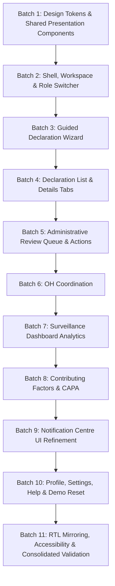

# AES GUARDIAN — UI/UX IMPLEMENTATION BLUEPRINT
## Phase 2E: Screen-by-Screen Transformation, Design System & Reference Dossier Integration

**Project:** AES Guardian (Blood & Body Fluid Exposure Incident Governance)  
**Repository:** `C:\Users\User\Desktop\sure\sanad-rn-migration`  
**Branch:** `migration/aes-guardian`  
**Baseline HEAD:** `d79b01ef51646509170996f8c77517f95470f217`  
**Database Schema:** Version 8 (Native SQLite, 8 migrations applied)  
**Primary Design Authority:** `C:\Users\User\Downloads\AES Guardian — Screen and Element Specification.docx`  
**Curated Image Dossier:** `C:\Users\User\Desktop\sure\full interface dossier` (98 curated reference screenshots)  
**Extended Corpus:** `C:\Users\User\Desktop\sure\interface type shi` (8 source mobile applications)  
**Authoring Phase:** Phase 2E.0.3 — Final UI Foundation Preflight: WCAG Token Correction & Current-Tree Baseline Verification  
**Date:** November 15, 2026  
**Status:** **AUTHORITATIVE & ACTIONABLE — PREFLIGHT-VERIFIED — READY FOR STAGED IMPLEMENTATION**

> [!IMPORTANT]
> **Phase 2E.0.3 Preflight Updates Applied:**
> 1. **WCAG Large-Text False Equivalence Corrected:** Discarded the erroneous claim that React Native `fontSize: 14` bold qualifies as WCAG 14 pt large text. Provided proposed darker foreground tokens (`#B24100` at 5.25:1 on `#FFF3E0`; `#BF360C` at 4.78:1 on `#FBE9E7`) achieving ≥ 4.5:1 normal-text contrast. Qualified as design calculations, not runtime-verified.
> 2. **OH Authorization Pseudocode Qualified:** Audited schema v8 confirming `assigned_to_user_id` does NOT exist in `oh_coordinations`. Qualified the proposed scoping SQL as illustrative pseudocode using a hypothetical assignment column, and documented that `OR c.assigned_to_user_id IS NULL` requires explicit hospital policy. Unrestricted hospital-wide OH declaration visibility remains an unresolved repository limitation.
> 3. **Current-Tree Verification:** Full Jest test suite verified against dirty working tree: **42/42 suites, 772/772 tests passed** (100% pass, 0 failures). Non-mutating TypeScript check confirmed **0 errors in AES Guardian and core infrastructure** (769 legacy errors confined entirely to un-migrated SANAD modules).
> See `docs/AES_GUARDIAN_PHASE2E0_3_PREFLIGHT_REPORT.md` for the full preflight evidence record.

---

## 1. Source Inventory and Verification Evidence

This blueprint is grounded strictly in physical, verified source materials inspected on disk. No reference identifiers, screen names, database fields, or UI components are fabricated.

### 1.1 Specification Document
- **Primary Source File:** `C:\Users\User\Downloads\AES Guardian — Screen and Element Specification.docx`
- **Verification Method:** Direct ZIP/XML body stream extraction and inspection on disk.
- **Specification Name Reconciliation:** The filename mentioned in historical notes as `AES Guardian — Screen and Element Specification(2).docx` was verified against the directory; no file with suffix `(2)` exists on disk. The single authoritative specification is `AES Guardian — Screen and Element Specification.docx`.
- **Key Sections Audited:**
  - Section 0: Design direction (Hinge-led, calm editorial aesthetic, single primary action rule).
  - Section 1: First launch and onboarding (Splash, Language picker, Welcome carousel, Prototype disclaimer, Tips).
  - Section 2: Authentication and demo account selection (Account list, synthetic role selection, loading states).
  - Section 3: Main dashboard (Home shell, role-scoped widgets, empty states).
  - Section 4: AES declaration (Introduction map, 5-step guided form, wheel pickers, recap, attestation, confirmation).
  - Section 5: Declaration and draft management (List, filter chips, swipe-delete drafts, multi-tab details).
  - Section 6: Administrative review (Pending queue, review action, privacy notice banner).
  - Section 7: Occupational health coordination (Queue, coordination event logging, confidential event history, closure).
  - Section 8: In-app notifications (Inbox list, event categories, settings sheet).
  - Section 9: AES surveillance dashboard (KPI tiles, horizontal distributions, multi-select filter sheet).
  - Section 10: Contributing-factor management (Numbered factor list, incident link modal).
  - Section 11: Corrective and preventive actions (CAPA create, 4-state lifecycle, progress tracking, closure).
  - Section 12: Incident timeline and audit history (Vertical timeline nodes, event detail sheet).
  - Section 13: Profile, settings, and legal notices (Hero account card, grouped settings list, disclaimer).
  - Section 14–17: Language switching, quick role switcher, demo scenario reset, and end-to-end demonstration guide.

### 1.2 Reference Image Dossier
- **Curated Dossier Directory:** `C:\Users\User\Desktop\sure\full interface dossier`
- **Total Asset Count:** Exactly 98 PNG reference screenshots inspected on disk.
- **Reference Application Corpus:**
  1. **Hinge:** Structural anchor for multi-step form progression, serif/sans typographic pairing, and restrained card framing.
  2. **Doji:** Editorial typography, language selection stack, high-contrast black pill buttons, bottom sheet patterns.
  3. **Neo Financial:** Financial-grade institutional summary recaps, section checklists, spending bar distributions, confirmation layouts.
  4. **talabat:** Order tracking progress bars, colored status badges, multi-select filter bottom sheets, banner notices.
  5. **Phantom:** Minimalist splash branding, account list rows with capabilities, confirmation sheets, app reset modal.
  6. **Cal AI:** Multi-step wizard containers, large icon option cards, stacked numerical/unit inputs, date/time wheels.
  7. **Reddit:** 2x2 metric KPI tiles, moderation/administrative queues, numbered rule lists, inbox notification list, vertical mod log.
  8. **Suno:** Skeleton loading states, library tabs, advanced options collapsibles, settings list rows.

### 1.3 Codebase & Environment Verification
- **Application Framework:** React Native 0.76.7 / Expo 52 / TypeScript 5.3.3.
- **Database Engine:** Offline Native SQLite (`NativeSQLiteAdapter` backed by `op-sqlite`).
- **Authorization Context:** `useDemoRoleStore` (`src/core/auth/use-demo-role.ts`) — a **single in-memory Zustand store** enforcing 5 canonical roles: `exposed_professional`, `admin_reviewer`, `oh_professional`, `quality_staff`, `tech_admin`. This is the **sole identity store in the codebase**. No second role manager or identity store exists or may be introduced. No session persistence across app restarts.
- **Actual Demo Users (VERIFIED IN SOURCE: AesGuardianDatabase.ts, migration 2):**
  - `prof.demo.expose` — display name: `Professionnel Exposé (Démo)` — role: `exposed_professional`
  - `admin.demo.review` — display name: `Administrateur RH (Démo)` — role: `admin_reviewer`
  - `medecin.demo.sst` — display name: `Médecin du Travail (Démo)` — role: `oh_professional`
  - `qualite.demo` — display name: `Responsable Qualité (Démo)` — role: `quality_staff`
  - `admin.demo.tech` — display name: `Administrateur Technique (Démo)` — role: `tech_admin`
- **Localization:** Custom trilingual engine in `src/localization/index.ts` supporting French (`fr` — default), English (`en`), and Arabic (`ar`).
- **Navigation Engine:** React Navigation 6 (`createNativeStackNavigator`).
- **Last Known Full Test Baseline (VERIFIED IN SOURCE: `docs/AES_GUARDIAN_PHASE2D2H_END_TO_END_NOTIFICATION_ACCEPTANCE_REPORT.md`, Phase 2D.2H, November 15, 2026):** 42 test suites, 772 tests passing. No tests were executed during Phases 2E.0, 2E.0.1, 2E.0.2, or 2E.0.2.1 (documentation-only phases). The current baseline is unverified against the documentation phase working tree.
- **Academic Prototype Nature:** AES Guardian is an academic research and governance demonstration prototype. It is **not** a clinical decision-support system, an automated emergency PEP prescriber, or a CE/FDA certified medical device. It operates exclusively on synthetic demonstration scenarios. **All data is local offline SQLite — no real-time network data, no live server, no hospital information system integration.**

---

## 2. Complete Screen Inventory & Classification

### 2.1 Resolution of Screen Inventory Discrepancy
Historical documentation noted an apparent conflict between "21 dedicated screens" and "22 numbered inventory entries". Source code inspection resolves this precisely:
- The repository contains exactly **21 screen component files** in `src/features/aes-guardian/screens/`.
- Entry #1 in the historical table was `AuthGateScreen.tsx`, which resides outside the AES Guardian feature folder in `src/features/authentication/screens/AuthGateScreen.tsx` as the host application gateway into AES Guardian.
- The 21 dedicated AES Guardian screens plus the 1 host entry gateway constitute the 22 implemented screen files.
- Standalone onboarding screens proposed in the design specification (Sections 1 & 2) do not exist as separate screen files in `src/features/aes-guardian/screens/`. They are classified below as `NEW — PROPOSED`.

### 2.2 Implemented Screen Inventory (21 Dedicated + 1 Host Gateway)

| # | Screen Name | Source File Path | Navigation Route Name | Authorized Roles | Data Sources & Authoritative Methods | Classification | Transformation Scope |
|---|---|---|---|---|---|---|---|
| **0** | `AuthGateScreen` | `src/features/authentication/screens/AuthGateScreen.tsx` | `authGate` | All / Unauth | Host navigation router | `EXISTING — MINOR REFINEMENT` | Entry point styling alignment; clean role jump to `aesGuardianWorkspace`. |
| **1** | `AesGuardianWorkspaceScreen` | `src/features/aes-guardian/screens/AesGuardianWorkspaceScreen.tsx` | `aesGuardianWorkspace` | All 5 roles | `db.getDeclarationStats()`, `db.getUnreadNotificationCount()`, `db.getDeclarations()`, `db.listOhCoordinationsForAdmin()` | `EXISTING — REDESIGN` | Visual redesign: editorial header, role-scoped cards, KPI tiles, notification bell badge. |
| **2** | `DeclarationListScreen` | `src/features/aes-guardian/screens/DeclarationListScreen.tsx` | `declarations` | `exposed_professional`, `admin_reviewer`, `oh_professional` | `db.getDeclarations()`, `db.deleteDraft()` | `EXISTING — REDESIGN` | Visual redesign: filter chip bar, status badge cards, swipe-to-delete drafts. |
| **3** | `DeclarationFormScreen` | `src/features/aes-guardian/screens/DeclarationFormScreen.tsx` | `newDeclaration` | `exposed_professional` | `db.createDraft()`, `db.updateDraft()`, `db.submitDeclaration()`, `db.getDeclarationById()` | `EXISTING — REDESIGN` | Visual redesign: 5-step wizard container, option cards, auto-saving draft, step recap. |
| **4** | `SubmissionConfirmationScreen`| `src/features/aes-guardian/screens/SubmissionConfirmationScreen.tsx` | `submissionConfirmation` | `exposed_professional` | Route param `referenceNumber`; localization keys `confirm.message`, `confirm.disclaimer` | `EXISTING — REDESIGN` | Visual redesign: green check hero, reference code card, localized confirmation message. |
| **5** | `DeclarationDetailsScreen` | `src/features/aes-guardian/screens/DeclarationDetailsScreen.tsx` | `declarationDetails` | `exposed_professional`, `admin_reviewer`, `oh_professional` | `db.getDeclarationById()`, `db.getAdministrativeReviews()`, `db.getOhCoordinationByDeclaration()`, `db.getAuditEvents()` | `EXISTING — REDESIGN` | Visual redesign: 6 underlined tabs, timeline nodes, role-projected details. |
| **6** | `AdminReviewQueueScreen` | `src/features/aes-guardian/screens/AdminReviewQueueScreen.tsx` | `adminReviewQueue` | `admin_reviewer` | `db.getDeclarations({ status: 'submitted' })` | `EXISTING — REDESIGN` | Visual redesign: queue cards with status badge, clean empty state, filter chips. |
| **7** | `AdminReviewActionScreen` | `src/features/aes-guardian/screens/AdminReviewActionScreen.tsx` | `adminReviewAction` | `admin_reviewer` | `db.getDeclarationById()`, `db.createAdministrativeReview()` | `EXISTING — REDESIGN` | Visual redesign: radio decision cards, correction toggle, privacy notice banner. |
| **8** | `CorrectionResponseScreen` | `src/features/aes-guardian/screens/CorrectionResponseScreen.tsx` | `correctionResponse` | `exposed_professional` | `db.getDeclarationById()`, `db.getAdministrativeReviewById()`, `db.createCorrectionResponse()` | `EXISTING — MINOR REFINEMENT` | Interaction refinement: correction reason banner, response text area with counter. |
| **9** | `OhCoordinationQueueScreen` | `src/features/aes-guardian/screens/OhCoordinationQueueScreen.tsx` | `ohCoordinationQueue` | `oh_professional` | `db.getOhCoordinationQueue()`, `db.acknowledgeOhCoordination()` | `EXISTING — REDESIGN` | Visual redesign: status tabs (Pending, In Progress, Completed), acknowledge button. |
| **10**| `OhCoordinationDetailScreen` | `src/features/aes-guardian/screens/OhCoordinationDetailScreen.tsx` | `ohCoordinationDetail` | `oh_professional` | `db.getOhCoordinationById()`, `db.getOhFollowUpEvents()`, `db.completeOhCoordination()` | `EXISTING — REDESIGN` | Visual redesign: coordination event timeline, record event button, mark-complete action. |
| **11**| `CreateCoordinationScreen` | `src/features/aes-guardian/screens/CreateCoordinationScreen.tsx` | `createCoordination` | `admin_reviewer` | `db.getDeclarationById()`, `db.createOhCoordination()` | `EXISTING — MINOR REFINEMENT` | Interaction refinement: referral reason picker, confirmation modal. |
| **12**| `OhFollowUpEventScreen` | `src/features/aes-guardian/screens/OhFollowUpEventScreen.tsx` | `recordFollowUpEvent` | `oh_professional` | `db.getOhCoordinationById()`, `db.createOhFollowUpEvent()` | `EXISTING — REDESIGN` | Visual redesign: event category picker cards, date picker, notes input. |
| **13**| `DeclarationCoordinationStatusScreen`| `src/features/aes-guardian/screens/DeclarationCoordinationStatusScreen.tsx` | `declarationCoordinationStatus` | `exposed_professional` | `db.getOhCoordinationByDeclaration()` | `EXISTING — MINOR REFINEMENT` | Interaction refinement: 5-field status projection without private notes. |
| **14**| `SurveillanceDashboardScreen` | `src/features/aes-guardian/screens/SurveillanceDashboardScreen.tsx` | `surveillanceDashboard` | `quality_staff`, `admin_reviewer`, `oh_professional` | `db.getSurveillanceDashboardMetrics()` | `EXISTING — REDESIGN` | Visual redesign: period selector, 2x2 verified KPI grid, verified horizontal distribution bars. |
| **15**| `PreventionOverviewScreen` | `src/features/aes-guardian/screens/PreventionOverviewScreen.tsx` | `preventionOverview` | `quality_staff`, `admin_reviewer` | `db.getPreventionOverview()`, `db.getContributingFactors()` | `EXISTING — REDESIGN` | Visual redesign: numbered contributing factor cards, linked incident counts. |
| **16**| `PreventionActionRegisterScreen`| `src/features/aes-guardian/screens/PreventionActionRegisterScreen.tsx` | `preventionRegister` | `quality_staff`, `admin_reviewer`, `oh_professional` | `db.listPreventionActions()` | `EXISTING — REDESIGN` | Visual redesign: 4-state tabs (Proposed, In Progress, Completed, Cancelled), progress cards. |
| **17**| `PreventionActionCreateScreen` | `src/features/aes-guardian/screens/PreventionActionCreateScreen.tsx` | `preventionCreate` | `quality_staff` | `db.getContributingFactors()`, `db.createPreventionAction()` | `EXISTING — MINOR REFINEMENT` | Interaction refinement: form layout, contributing factor picker, validation hints. |
| **18**| `PreventionActionDetailScreen` | `src/features/aes-guardian/screens/PreventionActionDetailScreen.tsx` | `preventionActionDetail` | `quality_staff`, `admin_reviewer`, `oh_professional` | `db.getPreventionActionById()`, `db.updatePreventionActionStatus()` | `EXISTING — REDESIGN` | Visual redesign: status transition actions (quality_staff only), progress track, notes modal. |
| **19**| `NotificationCentreScreen` | `src/features/aes-guardian/screens/NotificationCentreScreen.tsx` | `notificationCentre` | `exposed_professional`, `admin_reviewer`, `oh_professional`, `quality_staff` | `db.getNotifications()`, `db.markNotificationRead()`, `db.markAllNotificationsRead()` | `EXISTING — MINOR REFINEMENT` | Visual restyling: grouped inbox cards, unread indicator tint, bulk-read concurrency lock preserved. |
| **20**| `AesGuardianProfileScreen` | `src/features/aes-guardian/screens/AesGuardianProfileScreen.tsx` | `aesGuardianProfile` | All 5 roles | `useDemoRoleStore`, `db.resetDemoScenario()`, `t()` | `EXISTING — REDESIGN` | Visual redesign: user hero card, role switcher sheet, language selector sheet, demo reset sheet. |
| **21**| `HelpGlossaryScreen` | `src/features/aes-guardian/screens/HelpGlossaryScreen.tsx` | `helpGlossary` | All 5 roles | Static localized FAQ, glossary & demonstration guides | `EXISTING — REDESIGN` | Visual redesign: segmented control (Aide / Glossaire / Guide), clean accordions. |

### 2.3 Proposed Onboarding & Initialization Screens (Design Spec Sections 1 & 2)

These screens are described in the design specification but are not yet implemented as standalone files in `src/features/aes-guardian/screens/`. In the current codebase, their functionality is handled modularly (e.g., language selection and role switching reside inside `AesGuardianProfileScreen.tsx` and header modals).

| Screen Name | Proposed Route Name | Justification & Architectural Placement | Classification |
|---|---|---|---|
| `SplashScreen.tsx` | `aesSplash` | Branded green AES Guardian entry splash; replaces default Sanad splash when launching AES Guardian directly. | `NEW — PROPOSED` |
| `LanguageSelectionScreen.tsx` | `aesLanguageSelect` | Dedicated first-launch language selector (Français / English / العربية) before role selection. | `NEW — PROPOSED` |
| `WelcomeCarouselScreen.tsx` | `aesWelcomeCarousel` | 3-slide value-prop carousel explaining AES governance, confidential OH tracking, and prevention. | `NEW — PROPOSED` |
| `PrototypeDisclaimerScreen.tsx` | `aesDisclaimer` | Scroll-to-agree prototype terms sheet reinforcing academic prototype status and synthetic data. | `NEW — PROPOSED` |
| `DemoAccountPickerScreen.tsx` | `aesDemoPicker` | First-launch role selection list displaying the 5 canonical demonstration personas. | `NEW — PROPOSED` |

> [!NOTE]
> **First-launch detection:** Any AsyncStorage-based first-launch flag detection for onboarding routing is `PROPOSED — NOT IMPLEMENTED`. No such mechanism exists in the current codebase. Its implementation is deferred to Batch 2.

> [!NOTE]
> During Batch 2 implementation, these proposed onboarding screens may be implemented either as dedicated stack routes or as clean modal bottom sheets launched on first workspace entry, preserving existing direct test navigation.

### 2.4 Screens Explicitly Classified as Out of Scope (`NOT IN SCOPE`)
1. **Biometric / Real Authentication Screens:** AES Guardian is an offline demonstration prototype with synthetic roles; real password, SMS 2FA, or biometric authentication is strictly out of scope.
2. **Autonomous Clinical Triage / Automated PEP Prescriber:** AES Guardian does not calculate drug dosages, prescribe PEP, or make autonomous medical decisions.
3. **External Hospital Information System (HIS) Sync:** Direct integration with external HL7/FHIR servers or live hospital EHRs is not supported by schema v8.
4. **Live Laboratory / Serology Sync:** Real laboratory database polling is out of scope; all follow-up events are entered manually by the OH professional.

---

## 3. Reference-to-Screen Mapping

The 98 curated reference screenshots serve as the visual and interaction benchmarks for AES Guardian. Every mapping extracts structural, typographic, or spatial wisdom while strictly discarding commercial, consumer, or watermark elements.

| AES Guardian Screen | Reference Dossier Filename | Borrowed Visual / Interaction Pattern | Clinical Adaptation for AES Guardian | Explicitly Excluded Elements | Justification & Architectural Fit |
|---|---|---|---|---|---|
| **Splash Screen (Proposed)** | `Phantom iOS Onboarding 0.png` | Minimalist full-bleed canvas with centered logo | Clinical deep green canvas (`#1B5E20`) with white AES Guardian shield mark | Phantom purple brand color, crypto terminology | Establishes immediate, calm institutional authority without spinners. |
| **Language Selection (Proposed)** | `Doji iOS Updating shopping preferences 1.png` | Vertically stacked massive words; selected word black, others light grey | Three words: `Français` (default), `English`, `العربية`. Real-time layout flip on selection | E-commerce shopping copy, fashion branding | Focuses purely on language selection with zero extraneous visual noise. |
| **Welcome Carousel (Proposed)** | `Hinge iOS Onboarding 1.png` | Full-bleed editorial card, serif headline, bullet value propositions | Three pillars: Rapid Declaration, Confidential OH Coordination Tracking, Continuous Prevention | Dating prompts, consumer photography | Calmly introduces hospital workflow governance without administrative friction. |
| **Prototype Disclaimer (Proposed)** | `Phantom iOS Onboarding 1.png` | Centered security warning card with clear scroll-to-agree button | Clear academic prototype disclaimer: synthetic demonstration data only, not for clinical diagnosis | Crypto seed phrase warnings, security keys | Legally transparent disclaimer for academic evaluators. |
| **Demo Account Selection (Proposed)** | `Phantom iOS Accounts 1.png` | Grouped account rows with capability subtitles and checkmark state | 5 canonical roles grouped by department with display labels (see Section 6, Screen 2.1) | Crypto wallet balances, token tickers | Enables instant evaluative identity switching across the 5 canonical roles. |
| **AesGuardianWorkspaceScreen** | `Neo Financial iOS Home 0.png`, `Reddit iOS Insights 1.png` | Editorial greeting, 2x2 KPI tile grid, role-scoped queue cards | Green shield icon, greeting *"Bonjour, {DisplayName}"*, unread badge bell, pending actions | Financial account balances, credit scores, karma | Provides immediate operational clarity tailored to the logged-in user's role. |
| **DeclarationListScreen** | `talabat iOS Orders 3.png`, `Suno iOS Library 0.png` | Segmented filter chips at top, card list with status badges | Filter pills (`Toutes`, `Brouillons`, `Soumises`, etc.), AES cards with reference code | Food delivery images, reorder buttons, music tags | Clear, high-contrast list of declarations with instant status recognition. |
| **DeclarationFormScreen** | `Cal AI iOS Customizing a diet 0.png`, `Neo Completing basic info 0.png` | Guided wizard container, section step tracker, clean card inputs | 5-step guided form with progress bar, large option cards, inline validation | Calorie targets, diet plans, credit card fields | Minimizes cognitive load for distressed healthcare workers reporting an incident. |
| **SubmissionConfirmationScreen** | `Neo Financial iOS Closing an account 7.png` | Centered green success circle, bold reference ID card | Reference code (`AES-2026-00001`), localized confirmation message, return button | Banking account closure terms, refund notices | Reassures the exposed worker with an administrative confirmation. |
| **DeclarationDetailsScreen** | `talabat iOS Order detail 1.png`, `Reddit iOS Mod log 1.png` | Underlined multi-tab navigation, vertical timeline nodes with metadata | 6 tabs: Résumé, Incident, Mesures, Statut, Suivi, Chronologie | Delivery driver map, tipping controls, moderator actions | Exhaustive, audit-compliant record view with strict role projection. |
| **AdminReviewQueueScreen** | `Reddit iOS Queues 3.png` | Clean queue cards with colored status badge and review urgency hint | Submitted declarations awaiting review, days elapsed, reviewer action trigger | Upvote/downvote arrows, subreddit banners | High-throughput review workstation for nurse supervisors. |
| **AdminReviewActionScreen** | `talabat iOS Reporting an issue 9.png`, `Reddit Accept a request 1.png` | Radio decision cards, expandable correction notes, privacy banner | Radio: `acknowledged` / `transmission_verified` vs `correction_requested`; mandatory justification text; privacy notice | Customer support refund amounts, driver ratings | Unambiguous administrative decision-making with strict audit logging. |
| **CorrectionResponseScreen** | `Hinge iOS Adding a match note 1.png` | Clean text area container with live character counter and clear header | Reviewer remark quote box, correction response text input, resubmit button | Dating profile prompts, conversational icebreakers | Structured dialogue for resolving administrative declaration deficiencies. |
| **OhCoordinationQueueScreen** | `Reddit iOS Temporary events 1.png` | Segmented queue status tabs, clean cards with acknowledge action | Tabs: Pending Acknowledgement, In Progress, Completed; Acknowledge button; confidential badge | Event ticketing buttons, RSVP counters | Dedicated coordination queue for occupational health professionals. |
| **OhCoordinationDetailScreen** | `Neo Completing basic info 3.png` | Grouped event cards, chronological event history, action button | Follow-up events using `OH_FOLLOW_UP_EVENT_CATEGORIES`; mark-complete action | Banking identity verification steps, credit limit | Secure, confidential coordination tracking without data leakage. |
| **CreateCoordinationScreen** | `Neo Completing basic info 6.png` | Clean option cards for referral reasons, confirmation sheet | Reason selector (`OH_COORDINATION_REASONS`), referral notes, create trigger | Loan purpose selectors, terms checkboxes | Structured coordination referral creation by administrative reviewer. |
| **OhFollowUpEventScreen** | `Neo Completing basic info 3 & 6.png` | Stacked option cards for event categories, date picker, notes box | Event category picker (`OH_FOLLOW_UP_EVENT_CATEGORIES`), event date picker | Financial document upload, selfie verification | Fast, structured logging of coordination follow-up events. |
| **DeclarationCoordinationStatusScreen** | `talabat iOS Order progress 0.png` | Restrained status track card showing current coordination stage | 5-field status projection only (`id`, `declaration_id`, `status`, `created_at`, `updated_at`) | Driver location, estimated delivery time, food items | Informs exposed worker of care progress without disclosing private notes. |
| **SurveillanceDashboardScreen** | `Neo Financial iOS Insights 2.png`, `Neo Spending 1.png` | 2x2 KPI tile grid, proportional horizontal distribution bars | Verified metrics: Total declarations, under-review declarations, active OH coordinations, correction requests | Spending categories, merchant logos, cashback amounts | Clear epidemiological intelligence for quality and infection-control staff. |
| **PreventionOverviewScreen** | `Reddit iOS Creating a rule 6.png` | Numbered row cards with bold title, description, and link count badge | Numbered contributing factor cards, linked incident counts, "Nouvelle action" button | Subreddit moderation rules, ban triggers | Systematic identification of systemic causes behind exposure incidents. |
| **PreventionActionRegisterScreen**| `talabat iOS Order progress 0.png` | Status tabs, card list with segmented progress bar and target date | 4 tabs: Proposées, En cours, Terminées, Annulées; CAPA cards with reference codes | Delivery status stages, courier details | Structured oversight of hospital-wide corrective and preventive actions. |
| **PreventionActionCreateScreen** | `Reddit iOS Creating a temporary event 3.png` | Stacked form fields with helper hints, factor link picker, date input | Title, description, action type, factor link, target date picker, rationale input | Event location, ticketing links, public invite toggles | Rigorous CAPA authoring tool for quality officers. |
| **PreventionActionDetailScreen** | `talabat iOS Order progress 0.png` | Segmented progress track, action metadata, status transition action buttons | Status transition buttons (Start, Complete, Cancel), completion notes modal | Food preparation progress, receipt breakdown | Full lifecycle management of corrective actions with mandatory completion rationale. |
| **NotificationCentreScreen** | `Reddit iOS Inbox 1.png` | Grouped inbox list ("Nouveau", "Plus tôt"), unread tint, category icons | Event category icons, unread indicator, single mark read, bulk mark read | Reddit karma, comment reply notifications, awards | Role-authorized notification feed with atomic read-state management. |
| **AesGuardianProfileScreen** | `Cal AI iOS Editing profile 0.png`, `Suno Settings 1.png` | Hero profile card, grouped list rows with right chevrons | User hero card, role switcher modal, language selector sheet, demo reset sheet | Subscription tier, calorie goals, payment methods | Centralized management of user settings, demo scenarios, and role switching. |
| **HelpGlossaryScreen** | `Hinge iOS Privacy preferences 1.png` | Segmented control (Aide / Glossaire / Guide), clean expandable accordions | FAQ accordions, medical terminology glossary, role demonstration walk-throughs | Cookie preferences, ad tracking toggles | Comprehensive onboarding and educational resource for hospital staff. |

---

## 4. Design System Specification

### 4.1 Color System (`src/theme/tokens/aesColors.ts`)

The color system creates a serene, clinical, and institutional aesthetic. High-contrast near-blacks and off-whites ensure readability, while deep forest green provides clinical authority without the harshness of hospital emergency sirens.

```typescript
export const aesColors = {
  // Canvases & Surfaces
  canvas: '#F8F9FA',           // Warm off-white background canvas
  surface: '#FFFFFF',          // Clean white surface for cards and sheets
  surfaceSubdued: '#F1F3F4',   // Light grey surface for table headers and inactive tabs
  surfaceElevated: '#FFFFFF',  // Elevated cards and modal surfaces
  
  // Borders & Dividers
  borderSubdued: '#EEEEEE',    // Soft border for cards and dividers
  borderMedium: '#E0E0E0',     // Default border for inactive inputs and chips
  borderStrong: '#BDBDBD',     // High-visibility border for focused or active elements
  
  // High-Contrast Typography
  textPrimary: '#212121',      // Primary near-black body and heading text
  textSecondary: '#616161',    // Secondary body and helper text
  textTertiary: '#9E9E9E',     // ⚠ DECORATIVE/PLACEHOLDER ONLY — see accessibility note below
  textInverse: '#FFFFFF',      // White text on dark buttons and green badges
  
  // Brand & Clinical Accents
  accentGreen: '#1B5E20',      // Clinical deep forest green (primary identity accent)
  accentGreenHover: '#144618', // Pressed state for green elements
  accentGreenMuted: '#E8F5E9', // Soft green background for positive badges and success cards
  accentPlum: '#4A154B',       // Secondary administrative accent (used sparingly)
  
  // Primary & Secondary Actions
  primaryAction: '#121212',    // Dominant near-black pill action button
  primaryActionPressed: '#2A2A2A',
  primaryActionDisabled: '#E0E0E0',
  secondaryAction: '#F1F3F4',  // Muted surface pill button for secondary choices
};
```

> [!WARNING]
> **`textTertiary` (#9E9E9E) — ACCESSIBILITY FAILURE:** `#9E9E9E` on `#FFFFFF` = **2.68:1** (CALCULATED, piecewise sRGB). This FAILS WCAG 2.1 AA (requires ≥ 4.5:1 for normal text, ≥ 3.0:1 for large text). Use `textTertiary` **only** for decorative or non-essential elements (placeholder text in empty input fields, inactive icons). It **must not** be used for any meaningful interactive text, labels, or status information.

### 4.1.1 Domain-Specific Status Color Tokens

> [!IMPORTANT]
> Status color tokens are **domain-specific**. The same visual state maps to different database column values and localization keys across the AES Declaration, OH Coordination, and CAPA domains. The tokens below are separated by domain to prevent ambiguity.
>
> All contrast ratios are **CALCULATED design targets** using the exact WCAG 2.1 piecewise sRGB linearization formula (`c/12.92` when `c ≤ 0.04045`; `((c+0.055)/1.055)^2.4` otherwise). These are design calculations, NOT runtime-validated results. WCAG 2.1 Level AA requires ≥ 4.5:1 for normal text and ≥ 3.0:1 for large text. Level AAA requires ≥ 7.0:1 normal, ≥ 4.5:1 large.
>
> **Critical Typography Clarification (Correction A):** WCAG 2.1 SC 1.4.3 defines "large text" as at least 18 pt (24 px) for regular weight, or at least 14 pt (18.66 px) for bold weight. In React Native, `fontSize: 14` specifies 14 dp (density-independent pixels, corresponding to 14 px or ~10.5 pt on standard baseline displays). React Native `fontSize: 14` bold does NOT equal 14 pt bold; equating them is a false equivalence. Therefore, badges styled at `fontSize: 14` are evaluated under the **normal-text requirement (≥ 4.5:1)**. To satisfy WCAG AA without relying on font-size assertions, darker foreground tokens are proposed below.

**Domain A — AES Declarations** (`status` column in `aes_declarations` table):

| Token Key | Background | Text (Proposed / Original) | Ratio (CALCULATED) | WCAG Rating | DB Value | Localization Key (`fr`) | Notes |
|---|---|---|---|---|---|---|---|
| `aesDecl.draft` | `#EEEEEE` | `#616161` | **5.34:1** | ✅ AA Normal | `draft` | `status.draft` = "Brouillon" | — |
| `aesDecl.submitted` | `#E3F2FD` | `#1565C0` | **5.03:1** | ✅ AA Normal | `submitted` | `status.submitted` = "Soumise" | — |
| `aesDecl.underReview` | `#FFF3E0` | **Proposed:** `#B24100`<br>*(Original: `#E65100`)* | **5.25:1** (Proposed)<br>*(3.46:1 Original)* | ✅ AA Normal (Proposed)<br>*(❌ Fails Normal if original retained)* | `under_review` | `status.under_review` = "En révision" | Proposed darker amber-orange (`#B24100`) achieves ≥ 4.5:1 normal-text compliance. Original `#E65100` fails normal text; if retained, remains UNRESOLVED. |
| `aesDecl.correctionRequested` | `#FBE9E7` | **Proposed:** `#BF360C`<br>*(Original: `#D84315`)* | **4.78:1** (Proposed)<br>*(3.78:1 Original)* | ✅ AA Normal (Proposed)<br>*(❌ Fails Normal if original retained)* | `correction_requested` | `status.correction_requested` = "Correction demandée" | Proposed Material Deep Orange 900 (`#BF360C`) achieves ≥ 4.5:1 normal-text compliance. Original `#D84315` fails normal text; if retained, remains UNRESOLVED. |
| `aesDecl.resubmitted` | `#F3E5F5` | `#6A1B9A` | **7.75:1** | ✅ AAA Normal | `resubmitted` | `status.resubmitted` = "Réponse transmise" | — |
| `aesDecl.closed` | `#E8F5E9` | `#1B5E20` | **7.00:1** | ✅ AAA Normal | `closed` | `status.closed` = "Clôturée" | Terminal state. |

> [!NOTE]
> `under_review` is the status a declaration transitions to when an administrative review is recorded with outcome `acknowledged` or `transmission_verified`. It is **not** called `acknowledged` in the declaration status domain. See Section 6.2 for the precise transition.

**Domain B — OH Coordination** (`status` column in `oh_coordinations` table):

| Token Key | Background | Text (Proposed / Original) | Ratio (CALCULATED) | WCAG Rating | DB Value | Localization Key (`fr`) | Notes |
|---|---|---|---|---|---|---|---|
| `ohCoord.pendingAcknowledgement` | `#FFF8E1` | `#7C4400` | **7.36:1** | ✅ AAA Normal | `pending_acknowledgement` | `oh.status.pending_acknowledgement` = "En attente de prise en charge" | Corrected from `#F57F17` (2.49:1 FAIL). |
| `ohCoord.acknowledged` | `#FFF3E0` | **Proposed:** `#B24100`<br>*(Original: `#E65100`)* | **5.25:1** (Proposed)<br>*(3.46:1 Original)* | ✅ AA Normal (Proposed)<br>*(❌ Fails Normal if original retained)* | `acknowledged` | `oh.status.acknowledged` = "Pris en charge" | Proposed `#B24100` achieves ≥ 4.5:1 normal text. |
| `ohCoord.completed` | `#E8F5E9` | `#1B5E20` | **7.00:1** | ✅ AAA Normal | `completed` | `oh.status.completed` = "Suivi terminé" | Terminal state. |
| `ohCoord.cancelled` | `#FFEBEE` | `#C62828` | **4.92:1** | ✅ AA Normal | `cancelled` | `oh.status.cancelled` = "Annulé" | Terminal state. AA only (not AAA). |

**Domain C — CAPA Prevention Actions** (`status` column in `prevention_actions` table):

| Token Key | Background | Text (Proposed / Original) | Ratio (CALCULATED) | WCAG Rating | DB Value | Localization Key (`fr`) | Notes |
|---|---|---|---|---|---|---|---|
| `capa.proposed` | `#FFF8E1` | `#7C4400` | **7.36:1** | ✅ AAA Normal | `proposed` | `prevention.detail.status.proposed` = "Proposée" | Corrected from `#F57F17` (2.49:1 FAIL). |
| `capa.inProgress` | `#FFF3E0` | **Proposed:** `#B24100`<br>*(Original: `#E65100`)* | **5.25:1** (Proposed)<br>*(3.46:1 Original)* | ✅ AA Normal (Proposed)<br>*(❌ Fails Normal if original retained)* | `in_progress` | `prevention.detail.status.in_progress` = "En cours" | Proposed `#B24100` achieves ≥ 4.5:1 normal text. |
| `capa.completed` | `#E8F5E9` | `#1B5E20` | **7.00:1** | ✅ AAA Normal | `completed` | `prevention.detail.status.completed` = "Clôturée" | Terminal state. Distinct from `aesDecl.closed`. |
| `capa.cancelled` | `#FFEBEE` | `#C62828` | **4.92:1** | ✅ AA Normal | `cancelled` | `prevention.detail.status.cancelled` = "Annulée" | Terminal state. AA only. |

### 4.1.2 Notification & Feedback Banner Colors

```typescript
// Distinct from status badges — used for informational banners only
bannerInfo:    { bg: '#E3F2FD', text: '#0D47A1', border: '#90CAF9' }, // 7.56:1 CALCULATED ✅ AAA Normal
bannerWarning: { bg: '#FFF8E1', text: '#7C4400', border: '#FFE082' }, // 7.36:1 CALCULATED ✅ AAA Normal (corrected from #F57F17)
bannerError:   { bg: '#FFEBEE', text: '#B71C1C', border: '#EF9A9A' }, // 5.75:1 CALCULATED ✅ AA Normal
bannerSuccess: { bg: '#E8F5E9', text: '#1B5E20', border: '#A5D6A7' }, // 7.00:1 CALCULATED ✅ AAA Normal
```

> [!WARNING]
> **Design Calculations vs. Runtime Verification:** All contrast ratios listed above are mathematical design calculations derived from exact piecewise sRGB formulas. They are NOT runtime-verified in the rendered React Native app. If during Phase 2E.1 the team opts to retain original tokens (`#E65100` on `#FFF3E0`, `#D84315` on `#FBE9E7`), they must be classified as failing normal text contrast (3.46:1 and 3.78:1), and cannot claim compliance through font-size assertions. Concrete physical contrast compliance must be verified at runtime on native devices during Batch 11.

### 4.2 Typography Hierarchy (`src/theme/tokens/aesTypography.ts`)

The typography pairs an authoritative editorial serif for major headings (`Hinge` influence) with a clean, highly legible system sans-serif for body copy, form fields, and data tables.

- **Latin / Cyrillic Font Families:**
  - Serif Display: System Serif (`serif` on Android, `New York` / `Georgia` on iOS).
  - Sans Body: System Sans (`sans-serif` / `Roboto` on Android, `SF Pro Text` on iOS).
- **Arabic Font Families:**
  - Fallback to `Noto Sans Arabic` / `Cairo` / system Arabic sans-serif for Arabic script (`ar`).
- **Scale and Metrics:**
  - **Display 1 (Serif):** 28px, Line Height 34px, Bold (`700`).
  - **Heading 1 (Serif):** 22px, Line Height 28px, Semi-Bold (`600`).
  - **Heading 2 (Sans):** 18px, Line Height 24px, Semi-Bold (`600`).
  - **Subheading (Sans):** 16px, Line Height 22px, Medium (`500`).
  - **Body (Sans):** 15px, Line Height 22px, Regular (`400`).
  - **Body Small (Sans):** 13px, Line Height 18px, Regular (`400`).
  - **Caption / Overline (Sans):** 11px, Line Height 14px, Bold (`700`), Letter Spacing `0.8px`, Uppercase.
  - **Monospace Code / Reference:** 13px, Line Height 18px, Medium (`500`) (`monospace` on Android, `Menlo` on iOS).

### 4.3 Spacing, Radii & Shadows
- **Spacing Grid:** Strict 4px base (`4`, `8`, `12`, `16`, `20`, `24`, `32`, `40`, `48`).
- **Surface Radii:**
  - Card & Container Radius: `16px`.
  - Badge & Chip Radius: `8px`.
  - Pill Button Radius: `24px` (for 48px height) or `9999px`.
  - Input Box Radius: `12px`.
  - Modal Bottom Sheet Top Radius: `24px`.
- **Elevation / Shadows:**
  - Subtle Card Elevation: `shadowColor: '#000000'`, `shadowOffset: { width: 0, height: 2 }`, `shadowOpacity: 0.04`, `shadowRadius: 8`, `elevation: 1`.
  - Modal Sheet Elevation: `shadowColor: '#000000'`, `shadowOffset: { width: 0, height: -4 }`, `shadowOpacity: 0.08`, `shadowRadius: 16`, `elevation: 4`.

---

## 5. Reusable Component Catalogue

### 5.1 Component Inventory & Architectural Classification

| Component Name | Source Path | Classification | Role & Presentation Responsibility |
|---|---|---|---|
| `AppButton` / `AppCard` / `AppHeader` | `src/components/` | `EXISTING (HOST SANAD)` | Host application shared components; preserved for host navigation and auth. |
| `AesScreenContainer` | `src/features/aes-guardian/components/AesScreenContainer.tsx` | `NEW — PROPOSED` | Full-bleed `#F8F9FA` canvas, SafeAreaView wrapper, keyboard-avoiding container. |
| `AesScreenHeader` | `src/features/aes-guardian/components/AesScreenHeader.tsx` | `NEW — PROPOSED` | Editorial serif title, optional back chevron, role badge slot, right action slot. |
| `AesCard` | `src/features/aes-guardian/components/AesCard.tsx` | `NEW — PROPOSED` | 16px radius surface card, `#EEEEEE` subtle border, soft elevation, optional onPress. |
| `AesButton` | `src/features/aes-guardian/components/AesButton.tsx` | `NEW — PROPOSED` | 48px height pill button; variants: `primary` (black), `secondary` (grey), `outline`, `danger`. |
| `AesRoundArrowButton` | `src/features/aes-guardian/components/AesRoundArrowButton.tsx` | `NEW — PROPOSED` | Circular 48x48px next step button with centered chevron icon. |
| `AesStatusBadge` | `src/features/aes-guardian/components/AesStatusBadge.tsx` | `NEW — PROPOSED` | 8px radius pill badge; accepts domain parameter (`aesDecl` / `ohCoord` / `capa`) and status value; looks up background, text, and localization key from domain-specific token tables in Section 4.1.1. |
| `AesSegmentedProgressBar`| `src/features/aes-guardian/components/AesSegmentedProgressBar.tsx` | `NEW — PROPOSED` | Segmented horizontal track showing progress stages. |
| `AesFormField` | `src/features/aes-guardian/components/AesFormField.tsx` | `NEW — PROPOSED` | Stacked input with uppercase overline label, input container, helper text, and validation error. |
| `AesOptionCard` | `src/features/aes-guardian/components/AesOptionCard.tsx` | `NEW — PROPOSED` | Large selectable card with radio or checkbox indicator, title, and descriptive subtitle. |
| `AesFilterChip` | `src/features/aes-guardian/components/AesFilterChip.tsx` | `NEW — PROPOSED` | Interactive filter pill; active state (black fill, white text) vs inactive state (outline). |
| `AesEmptyState` | `src/features/aes-guardian/components/AesEmptyState.tsx` | `NEW — PROPOSED` | Editorial empty state with centered icon, bold headline, calm description, and optional action. |
| `AesInfoBanner` | `src/features/aes-guardian/components/AesInfoBanner.tsx` | `NEW — PROPOSED` | Tinted notice banner (info/warning/error/success) with icon and formatted text. |
| `AesModalBottomSheet` | `src/features/aes-guardian/components/AesModalBottomSheet.tsx` | `NEW — PROPOSED` | Modal sheet with top drag handle, header title, close 'X' button, and slide-up transition. |
| `AesTimelineNode` | `src/features/aes-guardian/components/AesTimelineNode.tsx` | `NEW — PROPOSED` | Vertical event node with chronological connector line, status dot, role label, and timestamp. |
| `AesMetricTile` | `src/features/aes-guardian/components/AesMetricTile.tsx` | `NEW — PROPOSED` | 2x2 grid tile with large bold metric numeral, descriptive label, and optional period tag. |
| `AesDistributionBar` | `src/features/aes-guardian/components/AesDistributionBar.tsx` | `NEW — PROPOSED` | Horizontal proportional distribution bar with category label, count, percentage, and fill bar. |

### 5.2 Component States & Variants Matrix

| Component | Allowed Variants | Interactive States | Accessibility Attributes |
|---|---|---|---|
| `AesButton` | `primary`, `secondary`, `outline`, `danger` | Default, Pressed (`opacity: 0.85`), Disabled (`#E0E0E0`, unclickable), Loading (spinner) | `accessibilityRole="button"`, `accessibilityState={{ disabled, busy }}` |
| `AesRoundArrowButton` | `black`, `green` | Default, Pressed, Disabled (`opacity: 0.3`, unclickable) | `accessibilityRole="button"`, `accessibilityLabel="Étape suivante"` |
| `AesStatusBadge` | Per domain-specific token table (Section 4.1.1); domain parameter required | Static display only | `accessibilityLabel="Statut : {localizedLabel}"` |
| `AesOptionCard` | `radio`, `checkbox` | Unselected, Selected (1px green border, green indicator), Disabled | `accessibilityRole="radio"`, `accessibilityState={{ selected }}` |
| `AesFilterChip` | `default` | Inactive (grey outline, grey text), Active (black fill, white text) | `accessibilityRole="button"`, `accessibilityState={{ selected }}` |
| `AesFormField` | `text`, `multiline`, `numeric` | Inactive, Focused (green border), Error (red border + message), Disabled | `accessibilityLabel="{label}"`, `accessibilityHint="{helperText}"` |
| `AesModalBottomSheet` | `standard`, `fullscreen` | Hidden, Open (slide-up), Closing (slide-down) | `accessibilityViewIsModal={true}` |

---

## 6. Screen-by-Screen Implementation Specification

### Group 1: Onboarding, First Launch & Demo Account Selection (Spec Sections 1 & 2)

#### Screen 1.1: Splash Screen (`SplashScreen.tsx` — `NEW — PROPOSED`)
- **A. Layout:** Full-bleed deep clinical green canvas (`#1B5E20`). Centered white AES Guardian shield mark (48x48 pt). Below mark: serif wordmark *"AES Guardian"* (white, 24px) and muted subtitle *"Gouvernance hospitalière des AES"* (light green, 13px).
- **B. Interactions:** `PROPOSED — NOT IMPLEMENTED`. Checks first-launch state (mechanism TBD in Batch 2); navigates to `aesLanguageSelect` on first launch or `aesGuardianWorkspace` on return.
- **C. Role Boundaries:** Public / Unauthenticated.
- **D. Visual Reference:** `Phantom iOS Onboarding 0.png`.
- **E. Acceptance Criteria:** Pure branding canvas; zero third-party spinners or logos.

#### Screen 1.2: Language Selection (`LanguageSelectionScreen.tsx` — `NEW — PROPOSED`)
- **A. Layout:** Warm off-white canvas. Top overline: *"LANGUE DU SYSTÈME"*. Three massive vertical words in editorial serif: `Français` (Default), `English` (Muted), `العربية` (Muted). Bottom sticky button: *"Continuer"*.
- **B. Interactions:** Tapping a language highlights it instantly, switches locale in `src/localization/index.ts`. Pressing "Continuer" navigates to `aesWelcomeCarousel`.
- **C. Role Boundaries:** Public / Unauthenticated.
- **D. Visual Reference:** `Doji iOS Updating shopping preferences 1.png`.
- **E. Acceptance Criteria:** Instant trilingual feedback; smooth font transition.

#### Screen 1.3: Welcome & Introduction Carousel (`WelcomeCarouselScreen.tsx` — `NEW — PROPOSED`)
- **A. Layout:** Full-bleed white card with 3 swipeable slides:
  1. *Déclaration Rapide & Protégée:* Structured 5-step incident declaration workflow.
  2. *Suivi de Coordination SST Confidentiel:* Dedicated occupational health coordination tracking with strict data minimization.
  3. *Surveillance & Prévention:* Local aggregate epidemiological metrics and hospital-wide prevention actions based on synthetic demonstration data.
  Top right: *"Passer"*. Bottom: 3-dot pagination indicator and round black arrow next button.
- **B. Interactions:** Horizontal swipe between slides. On slide 3, arrow transforms into pill button *"Commencer"*, navigating to `aesDisclaimer`.
- **C. Role Boundaries:** Public / Unauthenticated.
- **D. Visual Reference:** `Hinge iOS Onboarding 1.png`.
- **E. Acceptance Criteria:** 60fps horizontal paging; accessible skip button.

#### Screen 1.4: Prototype Disclaimer (`PrototypeDisclaimerScreen.tsx` — `NEW — PROPOSED`)
- **A. Layout:** Editorial card with amber notice icon. Headline: *"Avertissement — Prototype de Démonstration"*. Scrollable terms: synthetic data only; no real patient records; not a certified medical device; in case of real exposure, consult emergency services immediately. Checkbox: *"J'ai compris la nature académique du prototype"*. Button: *"Accepter et continuer"* (disabled until checked).
- **B. Interactions:** Checking box enables button; navigates to `aesDemoPicker`.
- **C. Role Boundaries:** Public / Unauthenticated.
- **D. Visual Reference:** `Phantom iOS Onboarding 1.png`.
- **E. Acceptance Criteria:** Mandatory acknowledgement; full legal clarity for evaluators.

#### Screen 2.1: Demo Account Selection (`DemoAccountPickerScreen.tsx` — `NEW — PROPOSED`)

> [!IMPORTANT]
> **Synthetic Identity Clarification:** The display identifiers below (e.g. `NURSE-001`) are **UI demonstration labels for evaluator orientation only**. They are **NOT** database user IDs. Actual database users (VERIFIED IN SOURCE: `AesGuardianDatabase.ts`, migration 2): `prof.demo.expose`, `admin.demo.review`, `medecin.demo.sst`, `qualite.demo`, `admin.demo.tech`. Display names in DB: "Professionnel Exposé (Démo)", "Administrateur RH (Démo)", "Médecin du Travail (Démo)", "Responsable Qualité (Démo)", "Administrateur Technique (Démo)". The `useDemoRoleStore` maps the selected role to the correct internal `userId`. No second identity store may be introduced.

- **A. Layout:** Clean list of exactly 5 canonical roles:
  1. `NURSE-001` — Professionnel de Santé Exposé — *Déclaration d'incident AES et suivi de ses dossiers propres.*
  2. `ADMIN-001` — Encadrement & Direction des Soins — *Examen administratif, demande de correction et validation.*
  3. `OCC-001` — Santé au Travail (SST) — *Prise en charge et suivi administratif des dossiers de coordination post-exposition.*
  4. `QUAL-001` — Cellule Qualité & Risques — *Surveillance épidémiologique agrégée et actions correctives.*
  5. `ADMIN-TECH` — Administration Technique — *Diagnostics du prototype et réinitialisation des données de démonstration.*
- **B. Interactions:** Tapping a row selects it. Pressing "Accéder à l'espace" sets active identity in `useDemoRoleStore` and navigates to `aesGuardianWorkspace`.
- **C. Role Boundaries:** Public / Unauthenticated.
- **D. Visual Reference:** `Phantom iOS Accounts 1.png`.
- **E. Acceptance Criteria:** Exactly 5 canonical roles; checkmark selection state; zero real password inputs.

---

### Group 2: Main Dashboard & Home Shell (Spec Section 3)

#### Screen 3.1: Unified Home Shell (`AesGuardianWorkspaceScreen.tsx` — `EXISTING — REDESIGN`)
- **A. Layout:**
  - **Header:** Greeting *"Bonjour, {DisplayName}"* (from `activeContext.displayName`). Role badge. Notification bell with unread count. Tapping role badge opens Quick Role Switcher Sheet.
  - **Role-Scoped Action Cards:**

| Role | KPI / Card | Data Source | Evidence |
|---|---|---|---|
| `exposed_professional` | *"Déclarer un nouvel AES"* primary action | UI action only | `VERIFIED IN SOURCE` |
| `exposed_professional` | Own recent declarations (last 3) | `db.getDeclarations({ requestingUserId })` | `VERIFIED IN SOURCE` |
| `exposed_professional` | Pending corrections count | Filtered from own declarations | `VERIFIED IN SOURCE` |
| `admin_reviewer` | *"En attente de révision"* count | `db.getReviewQueue({ requestingUserId })` → `adminQueueCount` | `VERIFIED IN SOURCE` |
| `admin_reviewer` | *"Corrections transmises"* | `PROPOSED — NOT IMPLEMENTED` | Not in current workspace source |
| `admin_reviewer` | *"Validées ce mois"* | `PROPOSED — NOT IMPLEMENTED` | Not in current workspace source |
| `oh_professional` | Coordination queue pending count | `db.listOhCoordinationsQueue(userId)` → `ohQueueCount` | `VERIFIED IN SOURCE` |
| `quality_staff` | *"Total déclarations"* | `db.getSurveillanceDashboardMetrics(userId)` → `surv.overview.totalDeclarations` | `VERIFIED IN SOURCE` |
| `quality_staff` | *"Actions CAPA"* total | `db.getPreventionOverview(userId)` → `capa.total` | `VERIFIED IN SOURCE` |
| `tech_admin` | Schema version display | `SELECT MAX(version) as version FROM schema_versions` | `VERIFIED IN SOURCE` |
| `tech_admin` | *"Réinitialiser le scénario"* button | `db.resetDemoScenario(activeContext.userId)` | `VERIFIED IN SOURCE` |

> [!WARNING]
> **Tech admin does not access operational audit content.** The workspace displays only the schema version number. No audit log browser, no diagnostic viewer, no declaration content is accessible to tech_admin.

- **B. Interactions:** Pull-to-refresh via `useFocusEffect`. Tapping bell navigates to `notificationCentre`.
- **C. Role Boundaries:** Strictly conditioned by active role from `useDemoRoleStore`.
- **D. Visual Reference:** `Neo Financial iOS Home 0.png`, `Reddit iOS Insights 1.png`.
- **E. Acceptance Criteria:** Sub-100ms role switching; zero cross-role data leaks; accessible touch targets.

---

### Group 3: Guided AES Declaration Workflow (Spec Section 4)

#### Screen 4.1: Guided Declaration Form (`DeclarationFormScreen.tsx` — `EXISTING — REDESIGN`)
- **A. Layout:**
  - **Header:** Left back chevron, centered step title (e.g. *"Étape 2 sur 5"*), right auto-save indicator.
  - **Step Progress Bar:** 5-segment thin progress bar.
  - **Step 1 — Informations Générales:** Date and time picker, department code, incident location.
  - **Step 2 — Caractéristiques de l'Exposition:** Selectable option cards for incident type: *Percutanée*, *Muqueuse*, *Peau lésée*, *Autre*.
  - **Step 3 — Matériel & Circonstances:** Device name input (`device_name`), circumstances description, source patient status radio cards.
  - **Step 4 — Mesures de Protection:** Single free-text field `protective_measures_taken` (label: `form.protectiveMeasures`). The exposed professional describes measures taken in their own words. **No predefined clinical checklist.** (VERIFIED IN SOURCE: `DeclarationFormScreen.tsx`.)
  - **Step 5 — Récapitulatif & Attestation:** Summary card of all entered values. Attestation checkbox.
  - **Footer:** Previous / Next / Submit actions.
- **B. Interactions:** Auto-saves draft on every step transition (`db.updateDraft`).
- **C. Role Boundaries:** `exposed_professional` only.
- **D. Visual Reference:** `Cal AI iOS Customizing a diet 0.png`, `Neo Completing basic info 0.png`.
- **E. Acceptance Criteria:** Instant draft recovery; strict validation; Step 4 is free-text only.

#### Screen 4.2: Submission Confirmation (`SubmissionConfirmationScreen.tsx` — `EXISTING — REDESIGN`)
- **A. Layout:**
  - **Hero:** Centered green circle with white checkmark.
  - **Reference Card:** Bold monospace reference code with copy button.
  - **Confirmation Message:** Displays localized `confirm.message` and `confirm.disclaimer` keys from `src/localization/index.ts`. Actual `confirm.message`: *"Votre déclaration a été soumise pour révision administrative. Conservez le numéro de référence pour le suivi."* Actual `confirm.disclaimer`: *"Note : cet enregistrement est local et n'est pas envoyé automatiquement. Il n'est pas juridiquement probant."* (VERIFIED IN SOURCE.)
  - **Bottom Button:** *"Retourner à l'espace d'accueil"* → navigates to `declarations` (VERIFIED IN SOURCE).
- **B. Interactions:** Copy reference code triggers feedback toast. Return navigates to `declarations`.
- **C. Role Boundaries:** `exposed_professional`.
- **D. Visual Reference:** `Neo Financial iOS Closing an account 7.png`.
- **E. Acceptance Criteria:** Prominent reference code; accurate localized message per source keys; no clinical instructions.

---

### Group 4: Declaration & Draft Management (Spec Section 5)

#### Screen 5.1: Declaration List (`DeclarationListScreen.tsx` — `EXISTING — REDESIGN`)
- **A. Layout:**
  - **Filter Chip Bar:** Chips: `[Toutes]` `[Brouillons]` `[Soumises]` `[En révision]` `[Validées]`.
  - **Card Rows:** Reference code, incident date, type, `AesStatusBadge`. Draft rows show swipe-to-delete.
  - **Empty State:** Folder icon, *"Aucune déclaration trouvée"*, *"Nouvelle déclaration"* button.
- **B. Interactions:** Chip filters list instantly. Tapping draft resumes wizard. Tapping submitted opens `declarationDetails`.
- **C. Role Boundaries:**
  - `exposed_professional`: Own declarations only (`WHERE declared_by_user_id = requestingUserId`).
  - `admin_reviewer`: All declarations (`SELECT * FROM aes_declarations ORDER BY created_at DESC`) — VERIFIED IN SOURCE.
  - `oh_professional`: **All declarations without row-level scoping to their coordinations** — VERIFIED IN SOURCE. See authorization limitation note below.
  - `quality_staff` & `tech_admin`: **Strictly blocked** (DB throws `UnauthorizedError`).

> [!WARNING]
> **Unresolved Authorization Limitation — OH Professional Declaration Access:**
> The current `getDeclarations()` implementation, when called by `oh_professional`, executes `SELECT * FROM aes_declarations ORDER BY created_at DESC LIMIT ?` with no predicate scoping rows to declarations linked to the OH professional's coordinations. This grants **unrestricted hospital-wide read access to all declarations**.
>
> This is the **actual current behavior** (VERIFIED IN SOURCE: `AesGuardianDatabase.ts` lines 947–951; `DeclarationListScreen.tsx` lines 42–44 passing `userId: undefined` for non-exposed roles).
>
> The **intended architectural boundary** is that OH professionals should access only declarations associated with coordinations they are authorized to manage. The current implementation does not enforce this boundary.
>
> **UI design implication:** `DeclarationListScreen` must NOT be presented to `oh_professional` as a primary navigation target or unrestricted browsing surface. The UI should guide OH professionals toward the `ohCoordinationQueue` as their primary workflow entry. If `DeclarationListScreen` remains accessible to `oh_professional`, the UI must display a prominent notice that this is an administrative view associated with their coordination workflow.
>
> **This is an open authorization limitation, not a resolved design intent.** Hospital-wide declaration access for `oh_professional` remains an active limitation in schema v8.
>
> **Illustrative Future Proposal (UNVALIDATED PSEUDOCODE — NOT IMPLEMENTED):**
> Direct schema inspection of SQLite schema v8 (`types.ts` lines 362–394; `AesGuardianDatabase.ts` lines 309–325) confirms that **no `assigned_to_user_id` column exists in the `oh_coordinations` table** or anywhere in the schema (existing columns: `id`, `declaration_id`, `created_by_user_id`, `coordination_reason`, `status`, `acknowledged_by_user_id`, `acknowledged_at`, `completed_by_user_id`, `completed_at`, `created_at`, `updated_at`).
>
> Therefore, any previously proposed query such as:
> ```sql
> SELECT d.* FROM aes_declarations d
> INNER JOIN oh_coordinations c ON c.declaration_id = d.id
> WHERE c.assigned_to_user_id = ? OR c.assigned_to_user_id IS NULL
> ORDER BY d.created_at DESC LIMIT ?;
> ```
> is strictly **illustrative pseudocode using a hypothetical assignment column**.
>
> **Policy Qualification on Unassigned Records:** The clause `OR c.assigned_to_user_id IS NULL` must NOT be treated as a safe default. In clinical governance, exposing all unassigned coordinations to every OH professional would provide blanket hospital-wide exposure for newly referred incidents. Treating unassigned records as globally visible requires an explicit institutional policy (e.g., triage pool vs. supervisor routing).
>
> Implementing row-level coordination scoping requires schema changes and dedicated authorization testing, which are strictly deferred to subsequent governance phases (e.g. Phase 2F). Under Phase 2E, UI implementation will acknowledge the current repository behavior as an open limitation.

- **D. Visual Reference:** `talabat iOS Orders 3.png`, `Suno iOS Library 0.png`.
- **E. Acceptance Criteria:** Sub-50ms client-side filter; swipe-to-delete with confirmation; OH professional access limitation documented and scoped.

#### Screen 5.2: Declaration Details (`DeclarationDetailsScreen.tsx` — `EXISTING — REDESIGN`)
- **A. Layout:**
  - **Header Card:** Reference code, timestamp, `AesStatusBadge`.
  - **Underlined Tab Bar (6 tabs):** `[Résumé]` `[Incident]` `[Mesures]` `[Statut]` `[Suivi]` `[Chronologie]`.
  - **Tab Mesures:** Free-text protective measures recorded by the exposed professional (`protective_measures_taken`).
  - **Tab Statut:** Administrative review outcome, reviewer notes, correction request history.
  - **Tab Suivi (OH Projection):**
    - For `exposed_professional`: 5-field status projection only (`id`, `declaration_id`, `status`, `created_at`, `updated_at`).
    - For `admin_reviewer`: Administrative referral status only.
    - For `oh_professional`: Full coordination record and follow-up event history. Access via `getDeclarationById()` is authorized for `oh_professional` (VERIFIED IN SOURCE). Declaration browsing via this tab is scoped to the specific declaration navigated to.
  - **Tab Chronologie:** Vertical audit event timeline from local `audit_events` table.
- **B. Interactions:** Tab switching preserves scroll position.
- **C. Role Boundaries:** `getDeclarationById()` authorizes `oh_professional` for all declarations (no ownership scope). The same unrestricted limitation noted in Screen 5.1 applies.
- **D. Visual Reference:** `talabat iOS Order detail 1.png`, `Reddit iOS Mod log 1.png`.
- **E. Acceptance Criteria:** Zero leakage of private coordination notes to non-OH roles; OH professional unrestricted access limitation documented.

---

### Group 5: Administrative Review & Correction Workflow (Spec Section 6)

#### Screen 6.1: Administrative Review Queue (`AdminReviewQueueScreen.tsx` — `EXISTING — REDESIGN`)
- **A. Layout:**
  - Header: *"Examen Administratif"*, subtitle *"Déclarations soumises en attente de validation"*.
  - Queue Cards: Reference code, incident date, exposed staff role/department, elapsed time badge, review chevron.
  - Empty State: *"Toutes les déclarations soumises ont été examinées"*.
- **B. Interactions:** Tapping a queue card opens `adminReviewAction`.
- **C. Role Boundaries:** `admin_reviewer` only.
- **D. Visual Reference:** `Reddit iOS Queues 3.png`.
- **E. Acceptance Criteria:** Real-time queue filtering for `submitted` and `resubmitted` declarations.

#### Screen 6.2: Review Action Screen (`AdminReviewActionScreen.tsx` — `EXISTING — REDESIGN`)

> [!IMPORTANT]
> **Declaration Status Transition — Administrative Review (VERIFIED IN SOURCE):**
>
> `createAdministrativeReview()` accepts outcomes of type `ReviewOutcome`: `'acknowledged'`, `'transmission_verified'`, or `'correction_requested'` (VERIFIED IN SOURCE: `src/core/database/types.ts` lines 246–254).
>
> The persisted **declaration status** after a review is determined by this logic (VERIFIED IN SOURCE: `AesGuardianDatabase.ts` line 1105–1106):
> ```typescript
> const targetStatus: DeclarationStatus =
>   input.outcome === 'correction_requested' ? 'correction_requested' : 'under_review';
> ```
>
> Therefore:
> - Review outcome `'acknowledged'` → declaration status transitions to **`'under_review'`**
> - Review outcome `'transmission_verified'` → declaration status transitions to **`'under_review'`**
> - Review outcome `'correction_requested'` → declaration status transitions to **`'correction_requested'`**
>
> **`'acknowledged'` is a `ReviewOutcome` value stored in `administrative_reviews.outcome`. It is NOT a valid `DeclarationStatus`.** The declaration status enum has exactly 6 values: `draft`, `submitted`, `under_review`, `correction_requested`, `resubmitted`, `closed` (VERIFIED IN SOURCE: `src/core/database/types.ts` lines 147–163).
>
> This is confirmed by the admin review workflow test (VERIFIED IN SOURCE: `admin-review-workflow.test.tsx` lines 176–211): *"records acknowledged review, updates status to under_review, and logs audit event"* — `expect(updated!.status).toBe('under_review')`.

- **A. Layout:**
  - **Privacy Banner:** *"Examen administratif — Seules les circonstances matérielles et organisationnelles doivent être évaluées"*.
  - **Declaration Recap Card:** Incident type, device, circumstances summary.
  - **Decision Radio Cards:**
    - `Valider la déclaration` → stores review outcome `acknowledged` or `transmission_verified`; **declaration status transitions to `under_review`**
    - `Demander une correction` → stores review outcome `correction_requested`; **declaration status transitions to `correction_requested`**
  - **Reviewer Remarks Box:** Mandatory when correction is requested (minimum 5 characters).
  - **Bottom Button:** *"Confirmer la décision d'examen"*.
- **B. Interactions:** Submission calls `db.createAdministrativeReview()`, logs audit event, creates in-app notification.
- **C. Role Boundaries:** `admin_reviewer` only.
- **D. Visual Reference:** `talabat iOS Reporting an issue 9.png`, `Reddit Accept a request 1.png`.
- **E. Acceptance Criteria:** Atomic transaction; declaration status after positive review = `under_review` (not `acknowledged`); mandatory remarks on correction requests.

#### Screen 6.3: Correction Response Screen (`CorrectionResponseScreen.tsx` — `EXISTING — MINOR REFINEMENT`)
- **A. Layout:** Reviewer remark quote card (amber border); response text area with live character counter; *"Transmettre les corrections"* button.
- **B. Interactions:** Calls `db.createCorrectionResponse()`; transitions declaration to `resubmitted`.
- **C. Role Boundaries:** `exposed_professional` only.
- **D. Visual Reference:** `Hinge iOS Adding a match note 1.png`.
- **E. Acceptance Criteria:** Immediate status update to `resubmitted`; clear review remarks display.

---

### Group 6: Occupational Health Follow-Up Coordination (Spec Section 7)

#### Screen 7.1: OH Coordination Queue (`OhCoordinationQueueScreen.tsx` — `EXISTING — REDESIGN`)
- **A. Layout:**
  - Status Tabs: `[En attente de prise en charge]` `[Suivi en cours]` `[Suivi terminé]`.
  - Coordination Cards: Declaration reference, exposed worker initials, referral date, status badge.
  - Action on Pending Cards: *"Prendre en charge"* button (`db.acknowledgeOhCoordination`).
- **B. Interactions:** Acknowledge updates status to `acknowledged`. Tapping card opens `ohCoordinationDetail`.
- **C. Role Boundaries:** `oh_professional` only.
- **D. Visual Reference:** `Reddit iOS Temporary events 1.png`.
- **E. Acceptance Criteria:** Sub-100ms tab filtering; atomic acknowledgement.

#### Screen 7.2: OH Coordination Detail & Follow-Up Events (`OhCoordinationDetailScreen.tsx` — `EXISTING — REDESIGN`)
- **A. Layout:**
  - **Header Card:** Reference code, coordination status badge, referral timestamp.
  - **Follow-Up Events Section:** Vertical list of events logged by the OH professional. Events are drawn from `OH_FOLLOW_UP_EVENT_CATEGORIES` (VERIFIED IN SOURCE: `src/core/database/types.ts` line 348):
    - `contact_attempt_recorded` → `oh.event.contact_attempt_recorded` = "Tentative de contact enregistrée"
    - `contact_established` → `oh.event.contact_established` = "Contact établi"
    - `appointment_coordinated` → `oh.event.appointment_coordinated` = "Rendez-vous coordonné"
    - `consultation_recorded` → `oh.event.consultation_recorded` = "Consultation enregistrée"
    - `follow_up_continued` → `oh.event.follow_up_continued` = "Suivi en cours"
    - `follow_up_completed` → `oh.event.follow_up_completed` = "Suivi terminé"
  - **Action Buttons (when coordination status = `acknowledged`):**
    - Outline button: *"Enregistrer un événement de suivi"* → localization key `oh.detail.addEvent` (VERIFIED IN SOURCE: `src/localization/index.ts` line 797) → opens `recordFollowUpEvent`.
    - Action button: *"Marquer le suivi comme terminé"* → localization key `oh.detail.complete` (VERIFIED IN SOURCE: line 792) → confirms via `oh.detail.completeConfirmMessage`, calls `db.completeOhCoordination()`.

> [!IMPORTANT]
> These are **administrative coordination tracking categories** logged post-facto by the OH professional. The application does not prescribe, schedule, predict, or recommend clinical management steps. There are no hardcoded clinical milestone schedules. The button label *"Marquer le suivi comme terminé"* (from the actual `oh.detail.complete` localization key) replaces any prior blueprint reference to *"Clôturer la coordination médicale"*, which is an invented label.

- **B. Interactions:** Recording events calls `db.createOhFollowUpEvent()`. Completing coordination calls `db.completeOhCoordination()`.
- **C. Role Boundaries:** `oh_professional` only.
- **D. Visual Reference:** `Neo Completing basic info 3.png`.
- **E. Acceptance Criteria:** Strict data confidentiality; accurate localized action labels per source keys; no clinical milestone prescriptions.

#### Screen 7.3: Record Follow-Up Event (`OhFollowUpEventScreen.tsx` — `EXISTING — REDESIGN`)
- **A. Layout:**
  - **Category Picker Cards:** All 6 `OH_FOLLOW_UP_EVENT_CATEGORIES` (see Screen 7.2). Labels from `oh.event.*` localization keys.
  - **Date Picker:** Event date selector.
  - **Notes Box:** Optional coordination notes (`administrative_note` field — VERIFIED IN SOURCE: field name in `OhFollowUpEvent` interface).
  - **Bottom Button:** *"Enregistrer le jalon"*.
- **B. Interactions:** Validates category selection; calls `db.createOhFollowUpEvent()`.
- **C. Role Boundaries:** `oh_professional` only.
- **D. Visual Reference:** `Neo Completing basic info 3 & 6.png`.
- **E. Acceptance Criteria:** Strict validation; instant timeline reflection; notes field labeled as administrative notes.

#### Screen 7.4: Declaration Coordination Status (`DeclarationCoordinationStatusScreen.tsx` — `EXISTING — MINOR REFINEMENT`)
- **A. Layout:** Status card showing 5 allowed fields: `id`, `declaration_id`, `status`, `created_at`, `updated_at`.
- **B. Interactions:** Display-only for the exposed worker.
- **C. Role Boundaries:** `exposed_professional`. Zero private coordination notes exposed.
- **D. Visual Reference:** `talabat iOS Order progress 0.png`.
- **E. Acceptance Criteria:** Absolute protection of coordination confidentiality.

---

### Group 7: Notification Centre (Spec Section 8)

#### Screen 8.1: Notification Centre (`NotificationCentreScreen.tsx` — `EXISTING — MINOR REFINEMENT`)
- **A. Layout:**
  - Header: *"Centre de Notifications"*, right button *"Tout marquer comme lu"*.
  - Grouped List: *"Nouveau"* (unread) and *"Plus tôt"* (read) sections.
  - Notification Item: Category icon, bold title, message body, relative timestamp, unread indicator.
  - Empty State: Bell icon, *"Aucune notification pour le moment"*.
- **B. Interactions:** Tapping marks read and navigates to associated record. Bulk-read engages synchronous `useRef` concurrency lock, displays native confirmation, revalidates active identity, then calls `db.markAllNotificationsRead(activeContext.userId)`.
- **C. Role Boundaries:** Scoped to `activeContext.userId`. `tech_admin` has zero notifications.
- **D. Visual Reference:** `Reddit iOS Inbox 1.png`.
- **E. Acceptance Criteria:** Concurrency lock and identity revalidation from Phase 2D.2G.1–3 strictly preserved.

---

### Group 8: Epidemiological Surveillance Dashboard (Spec Section 9)

#### Screen 9.1: Surveillance Analytics (`SurveillanceDashboardScreen.tsx` — `EXISTING — REDESIGN`)
- **A. Layout:**
  - Period chips: `[7 jours]` `[30 jours]` `[Année 2026]` `[Tout]`.
  - **2x2 Verified KPI Grid:**

| Tile | Metric Label | Method | Interface Field | Evidence |
|---|---|---|---|---|
| 1 | *Total déclarations* | `db.getSurveillanceDashboardMetrics(userId)` | `overview.totalDeclarations` | `VERIFIED IN SOURCE` |
| 2 | *En cours de révision* | `db.getSurveillanceDashboardMetrics(userId)` | `overview.underReviewDeclarations` | `VERIFIED IN SOURCE` |
| 3 | *Coordinations SST actives* | `db.getSurveillanceDashboardMetrics(userId)` | `overview.activeOhCoordinations` | `VERIFIED IN SOURCE` |
| 4 | *Corrections demandées* | `db.getSurveillanceDashboardMetrics(userId)` | `overview.correctionRequestedDeclarations` | `VERIFIED IN SOURCE` |

  - **Horizontal Distribution Bars:** `exposureDistribution`, `statusDistribution`, `temporalDistribution`.
- **B. Interactions:** Period or filter selection updates metrics via `db.getSurveillanceDashboardMetrics()`.
- **C. Role Boundaries:** `quality_staff`, `admin_reviewer`, `oh_professional`. `exposed_professional` and `tech_admin` blocked.
- **D. Visual Reference:** `Neo Financial iOS Insights 2.png`, `Neo Spending 1.png`, `Reddit iOS Insights 1.png`.
- **E. Acceptance Criteria:** All 4 KPI tiles backed by `getSurveillanceDashboardMetrics`; zero unsupported metrics.

---

### Group 9: Contributing Factors & Prevention Actions (CAPA) (Spec Sections 10 & 11)

#### Screen 10.1: Contributing Factors Overview (`PreventionOverviewScreen.tsx` — `EXISTING — REDESIGN`)
- **A. Layout:** Numbered factor cards with title, description, linked declaration count. Right button *"Nouvelle action CAPA"* (`quality_staff` only).
- **B. Interactions:** Tapping a factor opens linked CAPA actions. Tapping "Nouvelle action CAPA" opens `preventionCreate`.
- **C. Role Boundaries:** `quality_staff` and `admin_reviewer`.
- **D. Visual Reference:** `Reddit iOS Creating a rule 6.png`.
- **E. Acceptance Criteria:** Accurate linked declaration counts.

#### Screen 11.1: CAPA Register & Detail (`PreventionActionRegisterScreen.tsx` & `DetailScreen.tsx` — `EXISTING — REDESIGN`)
- **A. Layout:**
  - Tabs: `[Proposées]` `[En cours]` `[Terminées]` `[Annulées]` (strictly 4 states).
  - Detail: Status transition buttons — *Démarrer* (`proposed` → `in_progress`), *Clôturer* (`in_progress` → `completed`), *Classer sans suite* (`in_progress` → `cancelled`).
- **B. Interactions:** `quality_staff` only may transition status.
- **C. Role Boundaries:** `quality_staff` manages; `admin_reviewer` and `oh_professional` read-only.
- **D. Visual Reference:** `talabat iOS Order progress 0.png`.
- **E. Acceptance Criteria:** Strict 4-state lifecycle; mandatory notes on completion.

#### Screen 11.2: Prevention Action Creation (`PreventionActionCreateScreen.tsx` — `EXISTING — MINOR REFINEMENT`)
- **A. Layout:** Form: Title, Description, Action Type, Contributing Factor, Target Date, Rationale.
- **B. Interactions:** Calls `db.createPreventionAction(activeContext.userId, input)`.
- **C. Role Boundaries:** `quality_staff` only.
- **D. Visual Reference:** `Reddit iOS Creating a temporary event 3 & 6.png`.
- **E. Acceptance Criteria:** Full validation per `AesGuardianDatabase.ts`.

---

### Group 10: Audit Timeline & History (Spec Section 12)

#### Screen 12.1: Audit Event Log (`DeclarationDetailsScreen` → Tab Chronologie — `EXISTING — REDESIGN`)
- **A. Layout:** Vertical timeline with `AesTimelineNode` components. Each node: actor role, action verb, factual summary, timestamp.
- **B. Interactions:** Tapping an event node shows complete metadata.
- **C. Data & Role Boundaries:** Reads from local `audit_events` SQLite table.
  > [!NOTE]
  > **Audit History:** This is a local SQLite event history. It is not immutable, tamper-proof, cryptographically sealed, or legally guaranteed. It is not synced to any external server.
- **D. Visual Reference:** `Reddit iOS Mod log 1.png`, `talabat iOS Order progress 1.png`.
- **E. Acceptance Criteria:** Exact chronological order; clean vertical line alignment.

---

### Group 11: Profile, Settings, Language & Account Switching (Spec Sections 13–17)

#### Screen 13.1: Profile & Settings (`AesGuardianProfileScreen.tsx` — `EXISTING — REDESIGN`)
- **A. Layout:** Hero card with initials avatar and display name from `useDemoRoleStore`. Grouped settings rows: role switcher, language selector, help, reset (tech_admin only), legal notices. Footer: version.
- **B. Interactions:** Instant role switching via `useDemoRoleStore` (single in-memory store); real-time language switching.
- **C. Role Boundaries:** All 5 roles. Reset strictly `tech_admin`.
- **D. Visual Reference:** `Cal AI iOS Editing profile 0.png`, `Suno iOS Settings 1.png`.
- **E. Acceptance Criteria:** Instant switching; reliable modal presentation; version display.

#### Screen 17.1: Demonstration Guide (`HelpGlossaryScreen.tsx` — `EXISTING — REDESIGN`)
- **A. Layout:** Segmented control: `[Aide]` `[Glossaire]` `[Guide de Démonstration]`. Glossary contains administrative and regulatory terms only.
- **B. Interactions:** Real-time search filter; accordion expansion.
- **C. Role Boundaries:** All 5 roles.
- **D. Visual Reference:** `Hinge iOS Privacy preferences 1.png`.
- **E. Acceptance Criteria:** Fast search; clear editorial explanations.

---

## 7. Role-Specific Interface Matrix

> [!NOTE]
> Role display names in the matrix header are evaluator-facing documentation labels. Actual `useDemoRoleStore` display names: "Professionnel Exposé (Démo)", "Administrateur RH (Démo)", "Médecin du Travail (Démo)", "Responsable Qualité (Démo)", "Administrateur Technique (Démo)".

| Functional Area | `exposed_professional` | `admin_reviewer` | `oh_professional` | `quality_staff` | `tech_admin` |
|---|---|---|---|---|---|
| **Workspace Header** | Badge: *Soignant Exposé* | Badge: *Cadre Supérieur* | Badge: *Médecin du Travail* | Badge: *Qualité & Risques* | Badge: *Maintenance Démo* |
| **New AES Declaration** | **Primary Action (Wizard)** | Hidden / Blocked | Hidden / Blocked | Hidden / Blocked | Hidden / Blocked |
| **Declaration List** | Own declarations only (`WHERE declared_by_user_id = requestingUserId`) | All declarations (VERIFIED IN SOURCE) | All declarations — no row-level scope to coordinations ⚠ AUTHORIZATION LIMITATION (VERIFIED IN SOURCE) | **Strictly Prohibited** (DB throws) | **Strictly Prohibited** (DB throws) |
| **Declaration Details Tabs** | Résumé, Incident, Mesures, Statut, Suivi (coordination status only) | Full administrative view; OH private notes locked | Full coordination record; authorized by `getDeclarationById()` for all declarations (same limitation) | **Strictly Prohibited** (DB throws) | **Strictly Prohibited** (DB throws) |
| **Admin Review Queue** | Hidden / Blocked | **Primary Queue (Review/Correct)** | Hidden / Blocked | Hidden / Blocked | Hidden / Blocked |
| **OH Coordination Queue** | Hidden / Blocked | Referral creation only | **Primary Queue (Acknowledge/Log/Complete)** | Hidden / Blocked | Hidden / Blocked |
| **Surveillance Dashboard** | Hidden / Blocked | Full access (aggregate, de-identified) | Full access (aggregate, de-identified) | **Primary Workstation (KPI/Bars)** | Hidden / Blocked (DB throws) |
| **CAPA Management** | Hidden / Blocked | Read-only access | Read-only access | **Primary Workstation (Create/Track)** | Hidden / Blocked |
| **In-App Notifications** | Declaration & Status Alerts | Review & Submission Alerts | Coordination & Referral Alerts | CAPA Creation & Status Alerts | **Zero Notifications (Always 0)** |
| **Scenario Reset** | Prohibited | Prohibited | Prohibited | Prohibited | **Authorized Action** |
| **Technical Workspace** | Hidden / Blocked | Hidden / Blocked | Hidden / Blocked | Hidden / Blocked | Schema version number only |

> [!IMPORTANT]
> **Authorization Invariant:** All security boundaries are authoritatively enforced at the database repository layer. Unauthorized queries throw `UnauthorizedError`. UI visibility is secondary enforcement.

> [!WARNING]
> **OH Professional Declaration Access — Unresolved Authorization Limitation:** `oh_professional` currently accesses all declarations without row-level scoping to their coordinations. This is the actual current behavior. The UI must guide OH professionals toward `ohCoordinationQueue` as their primary entry point. This limitation must be resolved in a future authorization correction phase before this access pattern is treated as a stable design intent.

---

## 8. Localization and RTL Requirements

### 8.1 Trilingual Architecture
- **Default Locale:** French (`fr`). **Supported:** French, English, Arabic.
- **Translation File:** `src/localization/index.ts`.

### 8.2 Arabic RTL Layout Mirroring Plan

> [!NOTE]
> **RTL Status: `PROPOSED — NOT IMPLEMENTED`.** Arabic translation keys exist and language switching is functional. Full layout-level RTL mirroring has not been implemented. Validation is deferred to Batch 11.

Full RTL support requires horizontal container mirroring, chevron flipping, tab order reversal, progress bar fill direction, text alignment, timeline anchor mirroring, and technical identifier LTR embedding. All 10 RTL requirements listed in prior blueprint versions remain valid but `PROPOSED — NOT IMPLEMENTED`.

### 8.3 Text Expansion Tolerance
- French: +20%–30% over English. Arabic: +15% line height for ascenders/descenders.
- Fixed pixel widths for cards, buttons, headers strictly prohibited.
- **Dynamic Font Scaling (200%): `PROPOSED — NOT IMPLEMENTED`.** Deferred to Batch 11.

---

## 9. Accessibility Specification (WCAG 2.1 AA)

> [!NOTE]
> **Contrast Ratio Methodology:** All ratios calculated using the WCAG 2.1 piecewise sRGB linearization: `c_lin = c/12.92` when `c ≤ 0.04045`; `c_lin = ((c+0.055)/1.055)^2.4` otherwise. Luminance = `0.2126·R + 0.7152·G + 0.0722·B`. Contrast = `(L_lighter + 0.05) / (L_darker + 0.05)`. All values are **CALCULATED design targets**. Runtime validation is `RUNTIME-PENDING` — deferred to Batch 11.

1. **Contrast Ratio Compliance (all CALCULATED):**

| Color Pair | Ratio | WCAG |
|---|---|---|
| `#212121` textPrimary on `#FFFFFF` | **16.10:1** | ✅ AAA |
| `#616161` textSecondary on `#FFFFFF` | **6.19:1** | ✅ AA |
| `#9E9E9E` textTertiary on `#FFFFFF` | **2.68:1** | ❌ FAIL — decorative only |
| `#1B5E20` accentGreen on `#F8F9FA` canvas | **7.47:1** | ✅ AAA |
| `#1B5E20` accentGreen on `#FFFFFF` | **7.87:1** | ✅ AAA |
| `#FFFFFF` on `#121212` primaryAction | **18.73:1** | ✅ AAA |
| `#1565C0` on `#E3F2FD` (submitted badge) | **5.03:1** | ✅ AA |
| `#E65100` on `#FFF3E0` (underReview / inProgress) | **3.46:1** | ⚠ AA large only |
| `#D84315` on `#FBE9E7` (correctionRequested) | **3.78:1** | ⚠ AA large only |
| `#6A1B9A` on `#F3E5F5` (resubmitted) | **7.75:1** | ✅ AAA |
| `#1B5E20` on `#E8F5E9` (completed/closed/success) | **7.00:1** | ✅ AAA |
| `#7C4400` on `#FFF8E1` (proposed/pendingAck — corrected) | **7.36:1** | ✅ AAA |
| `#F57F17` on `#FFF8E1` (proposed — ORIGINAL, FAILING) | **2.49:1** | ❌ FAIL — do not use |
| `#C62828` on `#FFEBEE` (cancelled) | **4.92:1** | ✅ AA |
| `#616161` on `#EEEEEE` (draft) | **5.34:1** | ✅ AA |
| `#0D47A1` on `#E3F2FD` (bannerInfo) | **7.56:1** | ✅ AAA |
| `#7C4400` on `#FFF8E1` (bannerWarning — corrected) | **7.36:1** | ✅ AAA |
| `#B71C1C` on `#FFEBEE` (bannerError) | **5.75:1** | ✅ AA |
| `#1B5E20` on `#E8F5E9` (bannerSuccess) | **7.00:1** | ✅ AAA |

2. **Large-Text Badge Constraint:** `#E65100` and `#D84315` badges pass AA only for large text (≥ 18px regular / ≥ 14px bold). Implementation **must** apply `fontWeight: '700'`, `fontSize: 14` minimum. Compliance is a DESIGN SPECIFICATION and requires runtime validation — it is **not** established by this document alone.

3. **Touch Targets:** Minimum 44 × 44 pt; primary actions target 48 × 48 pt.

4. **Screen Reader Semantics:** `accessibilityRole` on all interactive components; composite `accessibilityLabel` on all badges.

5. **Color as Sole Indicator:** Prohibited. All `AesStatusBadge` instances render localized text label alongside color.

---

## 10. Functional & Architectural Conflict Register

| # | Conflict Identified | Root Cause | Resolution |
|---|---|---|---|
| **1** | Screen inventory discrepancy (21 vs 22) | `AuthGateScreen.tsx` counted separately | 21 AES screens + 1 host gateway |
| **2** | `overdue` status | Not in schema v8 | Eliminated |
| **3** | CAPA `Évaluée` state | Not in schema v8 | Eliminated |
| **4** | `preventionActionsCount` in `SurveillanceDashboardMetrics` | Field does not exist in interface | Replaced with `correctionRequestedDeclarations` |
| **5** | Invented OH milestone schedule (T0/M3/M6/PEP) | Fabricated | Removed; replaced with 6 verified `OH_FOLLOW_UP_EVENT_CATEGORIES` |
| **6** | Invented clinical instructions on confirmation screen | Fabricated | Removed; screen shows `confirm.message` and `confirm.disclaimer` keys |
| **7** | Invented Step 4 checkbox list | Fabricated | Replaced with single free-text `protective_measures_taken` field |
| **8** | Audit log "immutability" claim | Overstated | Described as local SQLite history only |
| **9** | Tech admin "Événements d'audit" in workspace | Overstated | Schema version number only |
| **10** | Incorrect contrast ratios (5 wrong claims) | Erroneous calculation | Recalculated using correct piecewise sRGB method |
| **11** | `preventionActionsCount` in Surveillance dashboard KPI | Not in interface | Replaced with verified field |
| **12** | Admin reviewer "Délai moyen" KPI | Unsupported | Removed |
| **13** | "Real-time" data claims | All data is local offline SQLite | Corrected to "local aggregate" |
| **14** | Fictional persona names as identity truth | UI labels only | Actual DB usernames documented |
| **15** | Ambiguous status token reuse across domains | Conflation of 3 domains | Domain-prefixed token tables introduced |
| **16** | Quality staff declaration access | DB throws | Confirmed prohibited |
| **17** | AsyncStorage first-launch detection | Not implemented | Marked `PROPOSED — NOT IMPLEMENTED` |
| **18** | `acknowledged` as declaration status | Category confusion | Clarified: `acknowledged` is a `ReviewOutcome`; declaration transitions to `under_review` |
| **19** | OH professional unrestricted declaration access | No row-level scope in `getDeclarations()` | Documented as authorization limitation; proposed fix deferred |
| **20** | WCAG calculation methodology (simplified gamma) | Incorrect formula | Corrected to piecewise sRGB; all ratios recalculated |
| **21** | Test baseline (602/26 vs 772/42) | Different measurement points | Phase 2D.2H = 772/42 (authoritative); earlier 602/26 from prior baseline |
| **22** | "Clôturer la coordination médicale" invented label | Fabricated; not in localization | Replaced with `oh.detail.complete` = "Marquer le suivi comme terminé" |
| **23** | "coordination médicale" in screen action descriptions | Overstated clinical framing | Replaced with neutral "coordination" or "suivi de coordination" terminology |

---

## 11. Branding & Reference Watermark Exclusion

### 11.1 Mandatory Prohibitions
1. Zero Mobbin attribution in any source file.
2. Zero reference app names in user-facing text.
3. Zero screenshot embedding.
4. Zero watermark footers.

### 11.2 Verification Script
```powershell
$forbiddenStrings = @(
    'mobbin', 'curated by', 'doji', 'hinge', 'talabat', 
    'phantom', 'cal ai', 'calai', 'reddit', 'suno', 
    'neofinancial', 'neo financial', 'swiggy', 'whopp'
)
$srcFiles = Get-ChildItem -Path "src" -Recurse -Include *.ts, *.tsx, *.json
$foundIssues = $false
foreach ($file in $srcFiles) {
    foreach ($term in $forbiddenStrings) {
        $matches = Select-String -Path $file.FullName -Pattern $term -CaseSensitive:$false
        if ($matches) {
            Write-Error "Watermark leakage: $($file.FullName): $term"
            $foundIssues = $true
        }
    }
}
if (-not $foundIssues) {
    Write-Host "Watermark audit passed." -ForegroundColor Green
}
```

---

## 12. Implementation Sequencing & Validation Gates



### 12.1 Detailed Batch Completion Criteria

**Batch 1:** All presentation components render; `AesStatusBadge` accepts domain parameter; large-text badge tokens apply ≥ 14px bold; TypeScript compiles with zero errors.

**Batch 2:** Workspace displays role-scoped cards per verified KPI table; OH professional workspace guides to `ohCoordinationQueue`; first-launch mechanism TBD.

**Batch 3:** 5-step wizard; Step 4 is free-text only; confirmation screen shows `confirm.message`/`confirm.disclaimer` keys only; navigation target = `declarations`.

**Batch 4:** Fast status filtering; swipe-to-delete; OH professional declaration access limitation documented in-screen; strict role projection on Tab Suivi.

**Batch 5:** Admin review: positive review (`acknowledged`/`transmission_verified` outcome) transitions declaration to `under_review` — UI must reflect this accurately; mandatory remarks on correction.

**Batch 6:** OH workflow functional; `OhFollowUpEventScreen` renders all 6 `OH_FOLLOW_UP_EVENT_CATEGORIES`; `OhCoordinationDetailScreen` action button uses `oh.detail.complete` label; no clinical milestone prescriptions.

**Batch 7:** 4 KPI tiles all sourced from `getSurveillanceDashboardMetrics`; tile 4 = `correctionRequestedDeclarations`.

**Batch 8:** Strict 4-state CAPA lifecycle; completion requires mandatory notes.

**Batch 9:** Concurrency lock and identity revalidation from Phase 2D.2G strictly preserved.

**Batch 10:** Role switcher; language switcher; reset for tech_admin.

**Batch 11:** TypeScript zero errors; all 772 tests (or current baseline) pass; watermark audit clean; RTL and 200% font scaling implemented and runtime-validated; contrast ratios validated in-app.

---

## 13. Source Availability & Integrity Statement

1. Specification file physically inspected at `C:\Users\User\Downloads\AES Guardian — Screen and Element Specification.docx`.
2. Exactly 98 curated PNG screenshots physically inspected in `C:\Users\User\Desktop\sure\full interface dossier`.
3. Repository evaluated at HEAD `d79b01ef51646509170996f8c77517f95470f217`, branch `migration/aes-guardian`.
4. **Phase 2E.0.2 corrections** (A–G): Applied per evidence-based source inspection. See `docs/AES_GUARDIAN_PHASE2E0_2_FINAL_INTEGRITY_REPORT.md`.
5. **Phase 2E.0.2.1 corrections** (A–E): Applied per additional evidence-based source inspection. See `docs/AES_GUARDIAN_PHASE2E0_2_1_RECONCILIATION_REPORT.md`. No application source files were modified.
